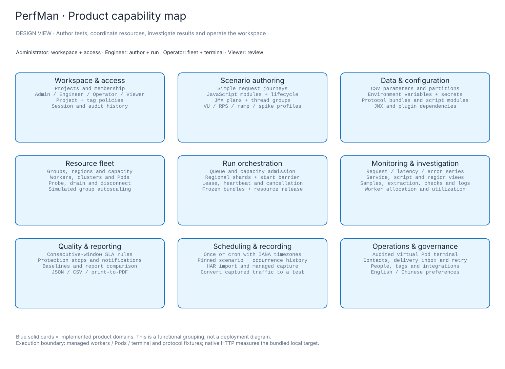
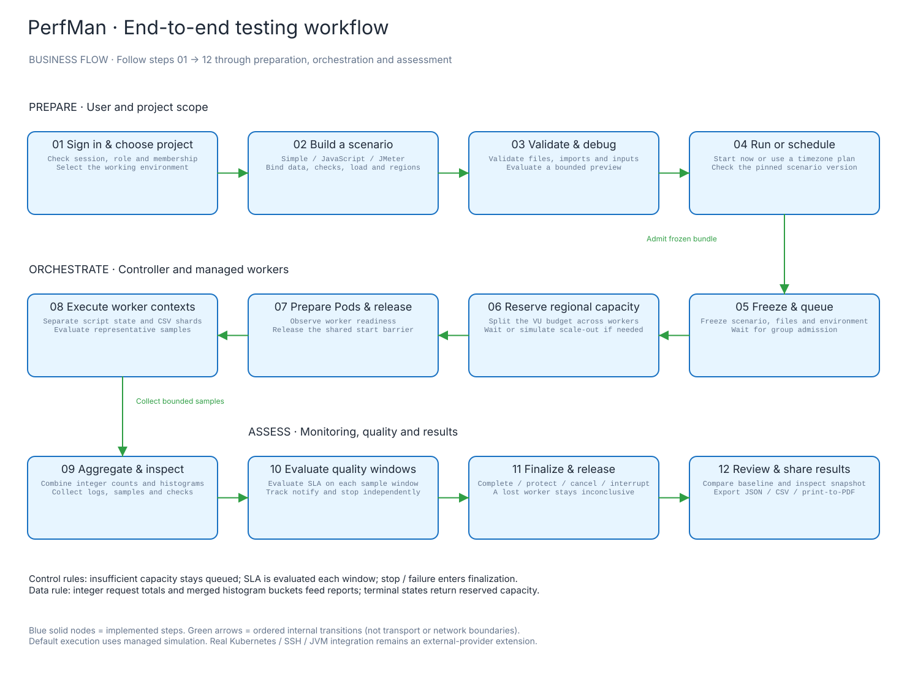
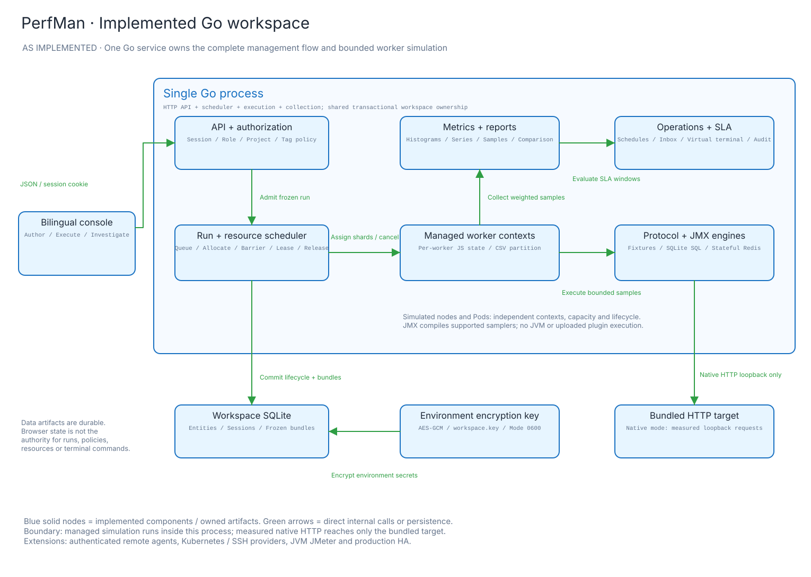
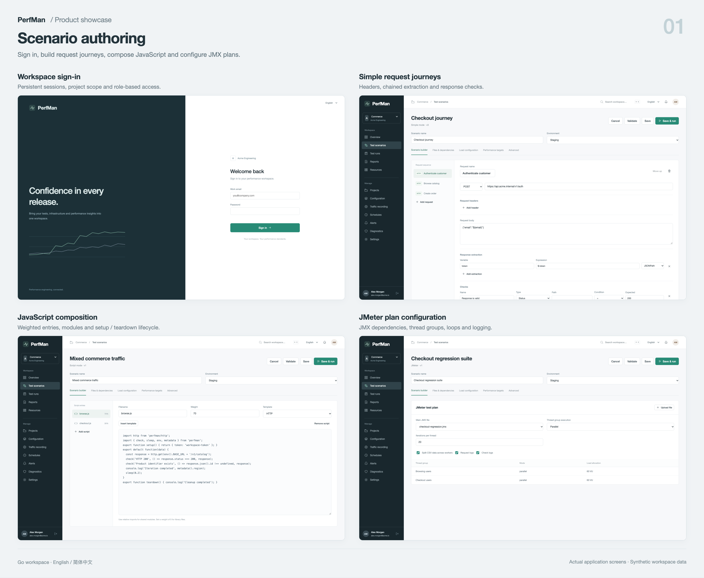
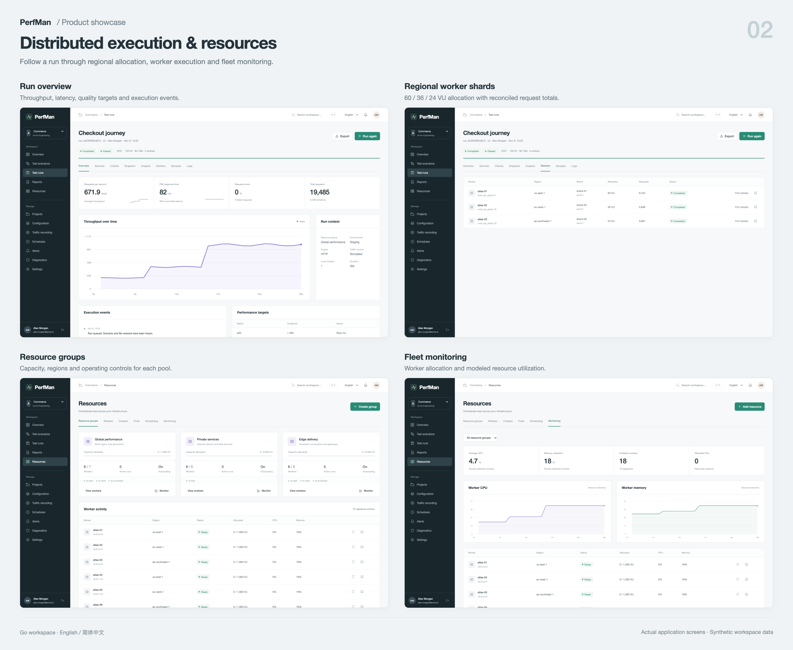
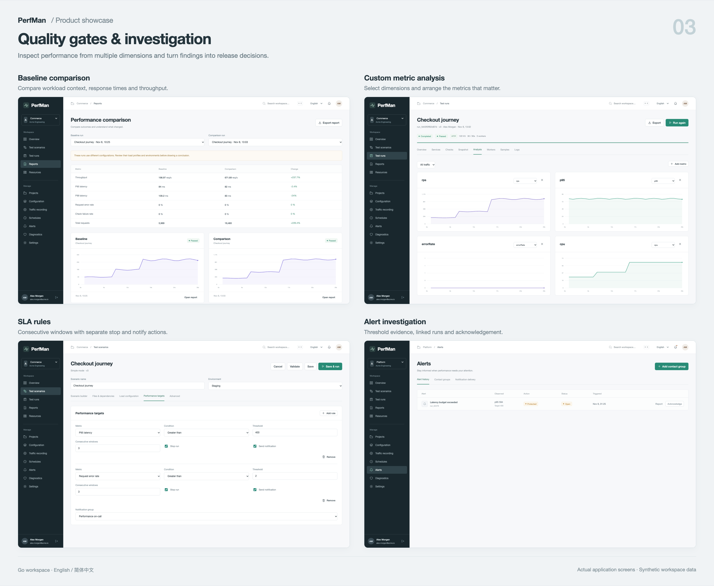
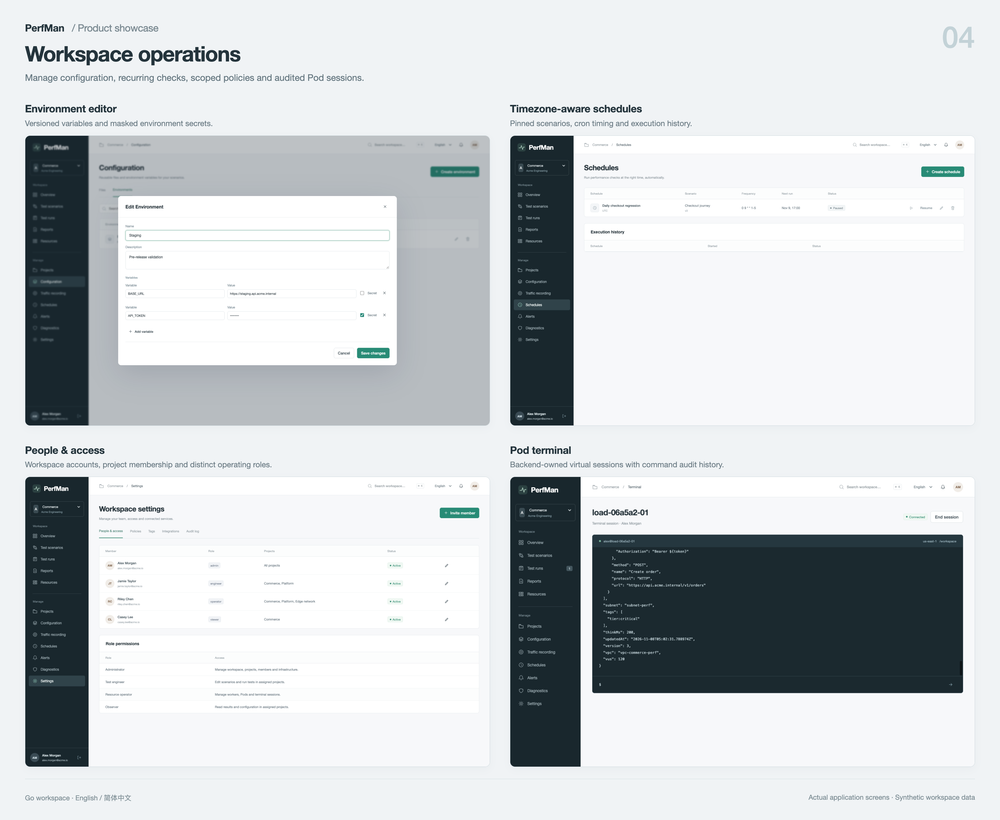

# PerfMan

PerfMan is an open-source performance testing workspace with a Go backend and a bilingual web console. Build user journeys, coordinate regional workers, inspect performance and make release decisions in one managed workflow.

English · [简体中文](README.zh.md)

[Quick start](#quick-start) · [Capabilities](#what-you-can-try) · [Workflow](#business-workflow) · [Architecture](#architecture) · [Screenshots](#product-showcase) · [Documentation](docs/README.md)

## Quick start

Install Go 1.26+ and a C compiler for SQLite (`clang` on macOS or `gcc` on Linux). From the repository root:

```sh
cd studio
go run ./cmd/perfman
```

Open [http://127.0.0.1:8099](http://127.0.0.1:8099). Sign in as **`alex.morgan@acme.io`** with **`PerfMan2026!`**. The console defaults to English; switch to 简体中文 in the top bar. Java, an external database and a frontend build step are not required for the Go workspace.

The first launch creates Acme Engineering with three projects, three resource groups, eighteen managed workers, twelve scenarios, environments, parameter files and eighteen historical runs. The sample accounts and business records are synthetic. Saved changes survive restarts.

| Account | Role | Starting point |
| --- | --- | --- |
| `alex.morgan@acme.io` | Administrator | Projects, people, policies and the complete workspace |
| `jamie.taylor@acme.io` | Engineer | Author scenarios, debug, run and inspect results |
| `riley.chen@acme.io` | Operator | Resource groups, workers, Pods and terminal sessions |
| `casey.lee@acme.io` | Viewer | Authorized Commerce scenarios, runs and reports |

All four fixture accounts share the initial password. Set `PERFMAN_INITIAL_PASSWORD` before initializing a new database to choose another password. Changing it later does not reset existing users. Each database is one organization workspace; cross-organization SaaS tenancy and billing are outside the current implementation.

## What you can try

| Workflow | Capabilities |
| --- | --- |
| Author realistic tests | Simple chained requests, executable JavaScript entries or a supported JMX plan. Configure headers, bodies, extraction, checks, think time and load profiles. |
| Reuse test assets | Bind CSV parameters, protocol bundles, request files, JavaScript modules and environment variables. Split CSV rows across workers and mask stored secrets. |
| Cover protocols | HTTP, gRPC, Protobuf, WebSocket, Socket.IO, SQL, Redis, TCP and UDP managed fixtures. SQL and Redis operations affect subsequent calls in their context. |
| Coordinate resources | Resource groups, regional traffic weights, node capacity, queued admission, group concurrency, simulated autoscaling, Pods and readiness barriers. |
| Investigate a run | Live series, service/script/region dimensions, custom metric charts, checks, logs, request samples and immutable scenario snapshots. |
| Apply quality gates | Consecutive-window SLA rules, independent protection/notification actions, alert history, acknowledgement and notification delivery records. |
| Automate and reuse traffic | Once/cron schedules with IANA timezones and occurrence history; HAR import, managed capture and recording-to-scenario conversion. |
| Review and operate | Baseline comparison, JSON/CSV export, print-to-PDF, resource probe/drain/disconnect, audited virtual terminals, project/tag policies and audit history. |

### Functional design



[PNG](docs/design/feature-map.png) · [Editable Excalidraw](docs/design/feature-map.excalidraw) · [Design and source evidence](docs/design/README.md)

## Business workflow

1. Sign in, select a project and prepare its environment and files.
2. Build a simple, JavaScript or JMeter scenario; add checks, extraction, load distribution and SLA rules.
3. Validate and debug, then start a run or create a timezone-aware schedule.
4. Follow admission, capacity reservation, Pod readiness and execution. Inspect metrics and samples, adjust an RPS run or stop it.
5. Review the quality verdict, investigate alerts and compare or export the finalized report. Reserved capacity returns to the group.



[PNG](docs/design/business-flow.png) · [Editable Excalidraw](docs/design/business-flow.excalidraw) · [Run lifecycle and failure paths](docs/design/README.md#run-lifecycle)

Insufficient capacity stays queued. Duration, cancellation, SLA protection and engine failure lead to finalization; a lost worker yields a partial, inconclusive result. A controller restart interrupts unfinished runs and releases their allocations.

## Architecture



[PNG](docs/architecture/saas-runtime.png) · [Editable Excalidraw](docs/architecture/saas-runtime.excalidraw) · [Evidence model](docs/architecture/saas-runtime-model.json)

| Layer | Implementation |
| --- | --- |
| Web console | Responsive HTML, CSS and JavaScript modules in [`studio/console/`](studio/console/), embedded in the Go binary and served without a frontend build. |
| API and access | [`workspace.go`](studio/workspace.go) handles the same-origin JSON API, cookie sessions, bcrypt passwords, project membership, validation and optimistic versions. [`workspace_policy.go`](studio/workspace_policy.go) refines access by project, tag and action. |
| Orchestration | [`workspace_scheduler.go`](studio/workspace_scheduler.go) owns schedules, queued admission, regional capacity, shards, readiness, cancellation, quality windows and release. |
| Execution | [`workspace_engine.go`](studio/workspace_engine.go) runs checks, extraction and Goja JavaScript contexts; [`workspace_jmeter.go`](studio/workspace_jmeter.go) compiles supported JMX samplers. [`workspace_protocols.go`](studio/workspace_protocols.go) supplies stateful fixtures. |
| Collection and reports | [`workspace_series.go`](studio/workspace_series.go) combines worker samples into series and integer budgets. [`workspace_metrics.go`](studio/workspace_metrics.go) exports scoped metrics. Histogram buckets are merged before computing quantiles. |
| Persistence | SQLite WAL stores workspace entities, sessions and frozen run bundles. Environment secrets use AES-GCM with a separate `workspace.key`. Files currently live in entity payloads. |

The application is a modular monolith with a single controller and one SQLite database. This keeps the complete workflow reproducible on a laptop. Real distributed deployment requires authenticated external agents, durable metric ingestion, a replicated storage design and production provider adapters. The [future target proposal](docs/architecture/solution-target.svg) is kept separate from the implemented runtime above.

## Product showcase

These are real application screenshots with synthetic workspace data. Select a board to view it at full resolution.

| Scenario authoring | Distributed execution and resources |
| --- | --- |
| [](docs/showcase/01-authoring.png) | [](docs/showcase/02-execution.png) |
| **Quality gates and investigation** | **Workspace operations** |
| [](docs/showcase/03-quality.png) | [](docs/showcase/04-operations.png) |

[Individual screens and capture notes](docs/showcase/README.md) · [Chinese console](docs/showcase/screens/chinese-resources.png) · [Mobile view](docs/showcase/screens/mobile-overview.png)

## Execution boundaries

The default provider models workers and Pods **inside one Go process**. Each allocated worker evaluates bounded representative samples; metrics scale to the requested logical load. Logical VU/RPS values are simulation results and do not measure hardware load-generator capacity.

| Provider area | Current behavior |
| --- | --- |
| Native HTTP | Real requests to the bundled loopback target, with measured total timing. It does not send to arbitrary external targets. |
| Network protocols | Managed fixtures for gRPC, WebSocket, Socket.IO, Redis, TCP/UDP and Protobuf. The Protobuf codec is a JSON round trip, not wire-compatible encoding. |
| Stateful data | SQL runs actual statements in a per-context in-memory SQLite dataset, with host database attachment blocked. Redis and socket fixtures maintain virtual state. |
| JMeter | Supported HTTP/TCP/WebSocket sampler plans, thread groups, loops, CSV bindings, throughput caps and assertions. No JVM, BeanShell/JSR223 or uploaded plugin code is executed. |
| Infrastructure and operations | Resource probes, clusters, Pods and terminals are backend-owned simulations. No Kubernetes API, SSH daemon or host shell is invoked. |
| Notifications and capture | The workspace inbox is functional; external email/webhook channels are simulated. Managed recording captures the bundled target; HAR import accepts supplied traffic. |

See the [implementation matrix](docs/product/IMPLEMENTATION.md) for exact behavior, limits and extension points. The management flow is implemented; external execution integrations should be added before advertising production cloud-load capabilities.

## Configuration and storage

| Variable | Default | Purpose |
| --- | --- | --- |
| `PERFMAN_ADDR` | `127.0.0.1:8099` | Listen address |
| `PERFMAN_DATA` | `data/workspace.db` | SQLite database path, relative to the working directory |
| `PERFMAN_INITIAL_PASSWORD` | `PerfMan2026!` | Initial fixture-account password for new databases only |

Back up SQLite using its backup API, or stop the service before copying the entire data directory. Keep `workspace.key` with the database: losing it prevents decryption of environment secrets. Copying only a live `.db` file can omit WAL changes. Runtime databases and keys are excluded from Git.

The [companion configuration repository](https://github.com/waiyuchan/perfman-config-repo) retains the former Spring configuration. The Go process uses environment variables; projects, environments, assets and policies are versioned workspace entities. The companion checkout includes a Go environment example and migration notes.

## Docker

From the repository root:

```sh
docker compose up --build
```

Open [http://127.0.0.1:8099](http://127.0.0.1:8099). The container runs as a non-root user and persists `/var/lib/perfman` in `perfman-data`. Compose passes `PERFMAN_INITIAL_PASSWORD` from the environment. The Docker configuration has not been run in the current validation environment because its Docker daemon is unavailable; native Go startup has been verified.

## Development and validation

From the repository root:

```sh
(cd studio && go test -race ./...)
(cd studio && go vet ./...)
node scripts/docs/check-docs.mjs
```

The current suite contains 23 top-level Go tests, including protocol scenario subtests and the earlier HTTP-engine tests. It covers authorization, snapshots, secrets, script limits, stateful fixtures, regional allocation, counter conservation, SLA, worker loss, terminal audit, schedules and persistence. See the [verification record](docs/product/VALIDATION.md) for observed browser workflows and untested external integrations.

Diagram generators, editable sources, contracts and screenshot layouts are included. [Documentation maintenance](scripts/docs/README.md) explains regeneration and asset validation.

## Documentation and project history

| Document | Purpose |
| --- | --- |
| [Documentation index](docs/README.md) | Architecture, product, API, visuals and research |
| [Product and workflow design](docs/design/README.md) | Functional map, business flow and lifecycle |
| [Implementation matrix](docs/product/IMPLEMENTATION.md) | Implemented behavior and provider boundaries |
| [Workspace API](docs/product/API.md) | Authoring, execution, operations and metrics endpoints |
| [Screenshot gallery](docs/showcase/README.md) | Individual screens, boards and capture provenance |
| [PTS feature review](docs/research/PTS_REVIEW_2026-11-08.zh.md) | Reference research across 53 official documentation pages |

The original Spring Cloud services remain for migration reference and are not needed to start the Go workspace. Their setup instructions are archived under [docs/legacy](docs/legacy/README.md). The active entry point is [`studio/cmd/perfman`](studio/cmd/perfman).

## License

Licensed under [Apache License 2.0](LICENSE).
