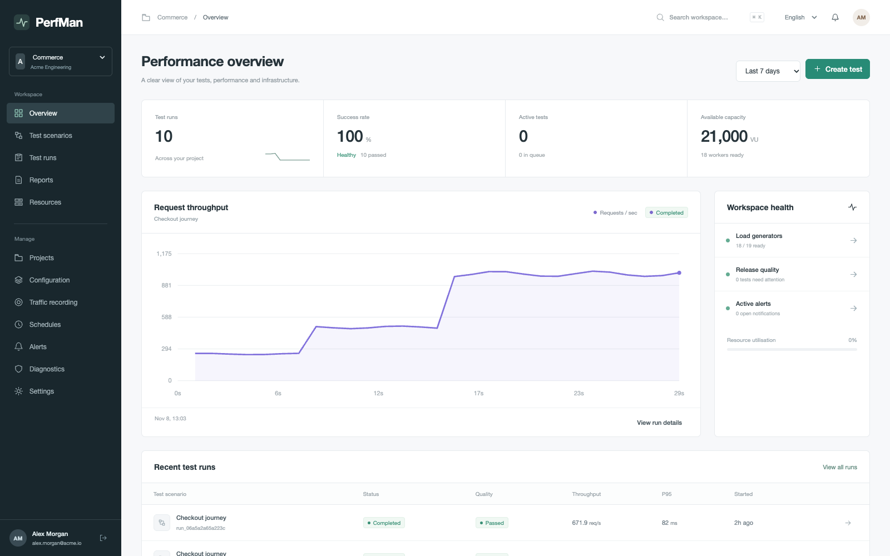
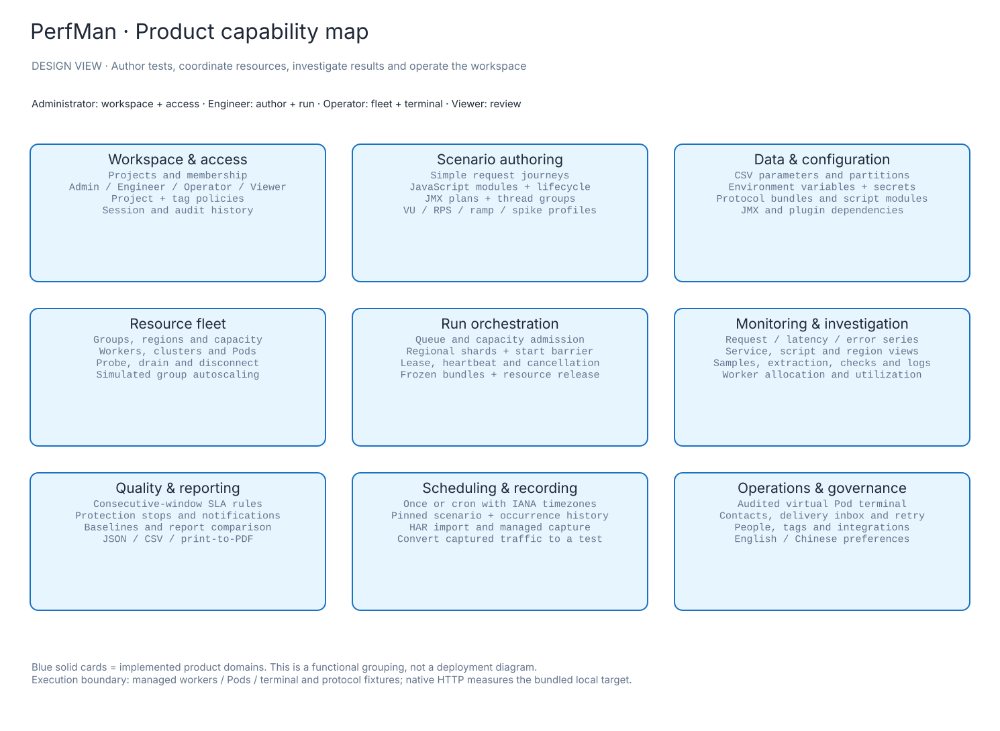
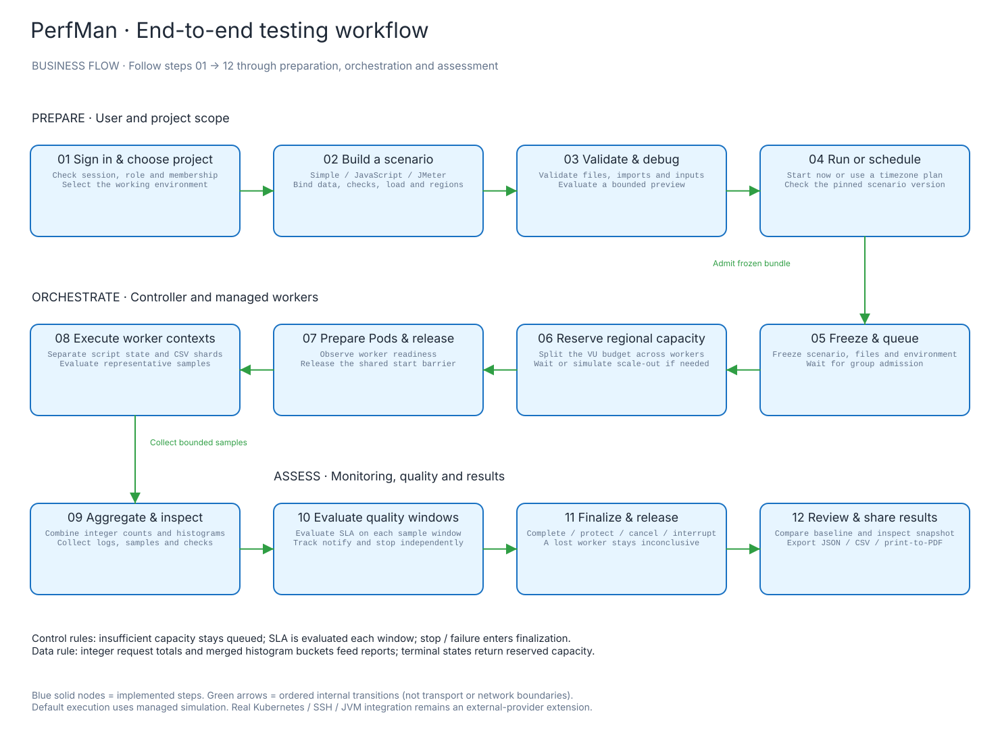
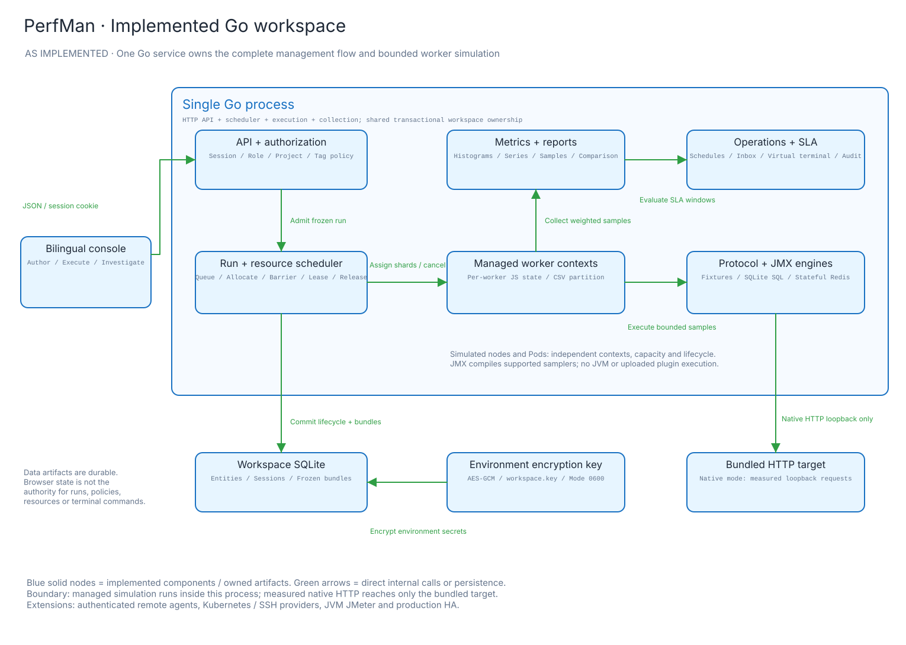
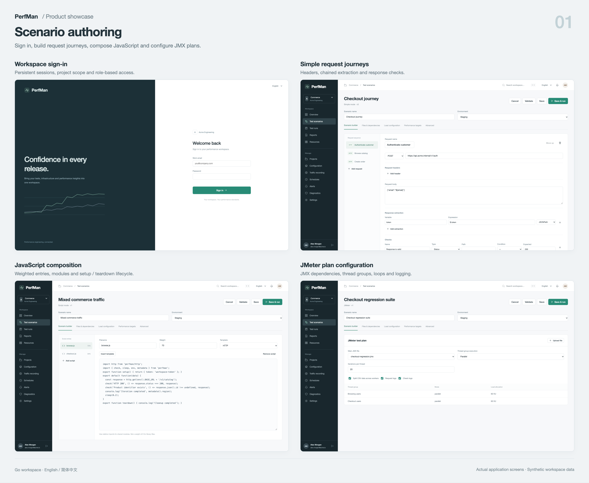
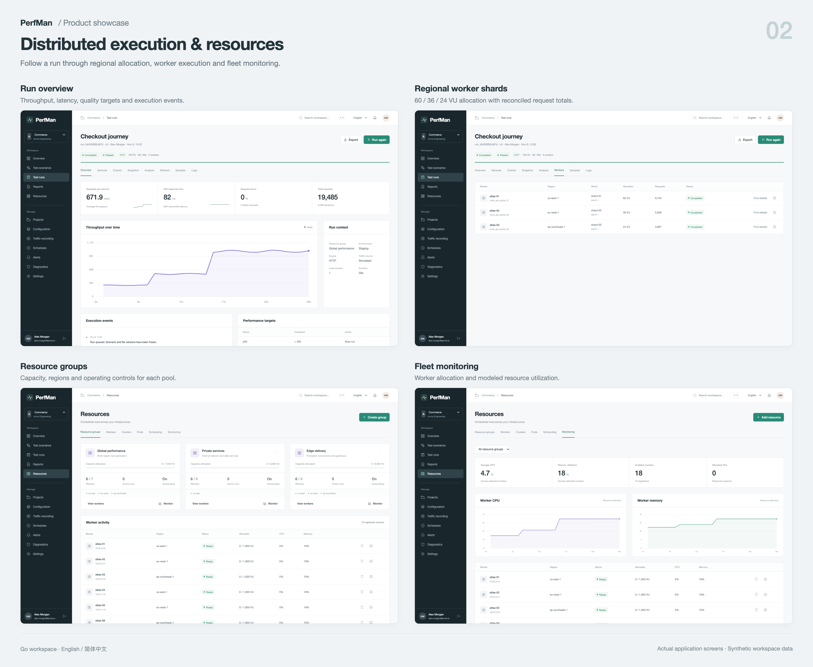
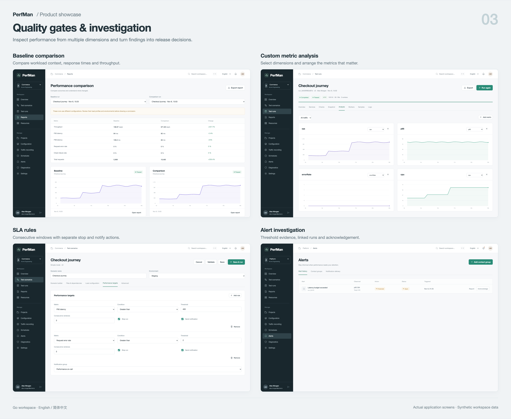
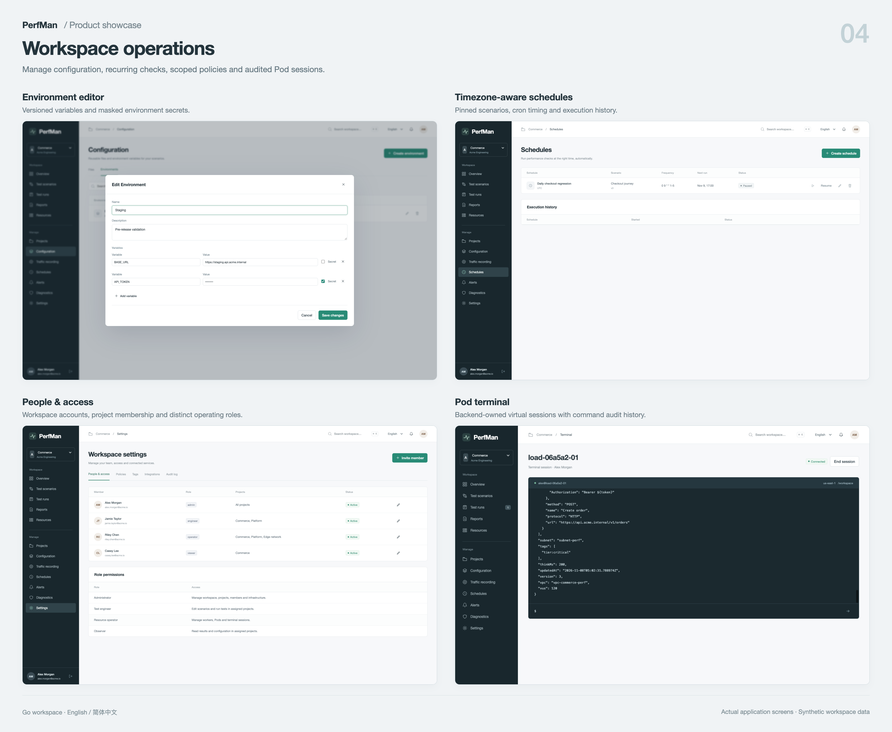

# PerfMan

PerfMan 是一个开源性能测试工作空间，采用 Go 后端和中英文控制台，将业务链路编排、多地域资源调度、性能分析和发布质量判断串成一套管理流程。

[English](README.md) · 简体中文

[](studio/go.mod) [](#配置与存储) [](#功能截图) [](LICENSE)

[快速启动](#快速启动) · [功能](#可以体验什么) · [业务流程](#业务流程) · [架构](#系统架构) · [截图](#功能截图) · [文档](docs/README.md)

[](docs/showcase/README.md)

## 快速启动

安装 Go 1.26+ 和 SQLite 所需的 C 编译器（macOS 的 clang 或 Linux 的 gcc），在仓库根目录执行：

```sh
cd studio
go run ./cmd/perfman
```

打开 [http://127.0.0.1:8099](http://127.0.0.1:8099)，使用 **`alex.morgan@acme.io`** / **`PerfMan2026!`** 登录。控制台默认英文，可在顶部切换简体中文。Go 工作空间无需启动 Java 服务、外部数据库或前端构建工具。

首次启动创建 Acme Engineering：3 个项目、3 个资源组、18 个托管节点、12 个场景，以及环境、参数文件和 18 条历史运行记录。账号和业务数据均为合成数据，保存的修改在重启后保留。

| 账号 | 角色 | 体验入口 |
| --- | --- | --- |
| `alex.morgan@acme.io` | 管理员 | 项目、成员、策略及完整工作空间 |
| `jamie.taylor@acme.io` | 工程师 | 场景编排、调试、执行和结果分析 |
| `riley.chen@acme.io` | 运维 | 资源组、节点、Pod 和终端 |
| `casey.lee@acme.io` | 只读用户 | 已授权的 Commerce 场景、运行和报告 |

四个初始化账号共用上述密码。可在新数据库初始化前设置 `PERFMAN_INITIAL_PASSWORD`；该变量不会重置已有账号。每个数据库对应一个组织工作空间，跨组织 SaaS 租户隔离和计费尚未实现。

## 可以体验什么

| 工作流 | 功能 |
| --- | --- |
| 编排真实测试链路 | 简单请求链路、可执行 JavaScript 或受支持的 JMX 计划；请求头、正文、提取器、检查点、思考时间和负载模型。 |
| 复用数据与配置 | CSV 参数、协议包、请求文件、脚本模块、环境变量、节点间 CSV 分片和加密密钥。 |
| 覆盖多种协议 | HTTP、gRPC、Protobuf、WebSocket、Socket.IO、SQL、Redis、TCP/UDP 托管夹具；SQL、Redis 操作会影响上下文内的后续调用。 |
| 管理执行资源 | 资源组、地域比例、节点容量、排队准入、组并行度、模拟扩容、Pod 和启动屏障。 |
| 监控与定位问题 | 实时序列、服务/脚本/地域维度、自定义图表、检查点、日志、请求采样和冻结快照。 |
| 控制发布质量 | 连续窗口 SLA、独立停止/通知动作、告警历史、确认处理及投递记录。 |
| 自动化与流量复用 | 带 IANA 时区的一次性/cron 计划、执行历史、HAR 导入、托管录制和录制转场景。 |
| 分析与运维 | 基线对比、JSON/CSV、打印 PDF、探测/排空/断开节点、可审计虚拟终端、项目/标签策略及操作审计。 |

### 功能设计图



[PNG](docs/design/feature-map.png) · [可编辑 Excalidraw](docs/design/feature-map.excalidraw) · [设计说明与代码依据](docs/design/README.md)

## 业务流程

1. 登录并选择项目，准备环境和测试文件。
2. 编排简单、JavaScript 或 JMeter 场景，设置检查点、提取器、负载分布和 SLA。
3. 校验、调试后立即运行，或配置带时区的执行计划。
4. 跟踪排队、容量预留、Pod 就绪和运行，查看指标与采样，按需调整 RPS 或停止。
5. 查看质量判定、定位告警、对比和导出报告；任务结束后归还资源。



[PNG](docs/design/business-flow.png) · [可编辑 Excalidraw](docs/design/business-flow.excalidraw) · [生命周期和失败路径](docs/design/README.md#run-lifecycle)

容量不足时任务保持排队。达到时长、取消、SLA 保护和引擎异常会进入结束处理；节点丢失产生部分完成、结果不完整的判定。控制器重启会将未完成任务标记为中断并释放分配。

## 系统架构



[PNG](docs/architecture/saas-runtime.png) · [可编辑 Excalidraw](docs/architecture/saas-runtime.excalidraw) · [代码依据](docs/architecture/saas-runtime-model.json)

| 层次 | 实现 |
| --- | --- |
| Web 控制台 | [`studio/console/`](studio/console/) 中的响应式 HTML/CSS/JavaScript，嵌入 Go 二进制，无需前端构建。 |
| API 与权限 | [`workspace.go`](studio/workspace.go) 实现同源 JSON API、Cookie 会话、bcrypt、项目成员、输入校验和乐观版本；[`workspace_policy.go`](studio/workspace_policy.go) 细化项目/标签/动作授权。 |
| 调度与生命周期 | [`workspace_scheduler.go`](studio/workspace_scheduler.go) 管理定时任务、排队准入、地域容量、分片、就绪、取消、质量窗口和资源释放。 |
| 执行引擎 | [`workspace_engine.go`](studio/workspace_engine.go) 执行检查点、提取和 Goja 脚本；[`workspace_jmeter.go`](studio/workspace_jmeter.go) 解析受支持的 JMX；[`workspace_protocols.go`](studio/workspace_protocols.go) 提供有状态夹具。 |
| 采集与报告 | [`workspace_series.go`](studio/workspace_series.go) 汇总节点样本、序列和整数预算；[`workspace_metrics.go`](studio/workspace_metrics.go) 导出受权限约束的指标。合并直方图桶后计算分位数。 |
| 持久化 | SQLite WAL 保存实体、会话和冻结执行包；AES-GCM 加密环境密钥，密钥文件为独立的 `workspace.key`。文件当前保存在实体数据中。 |

当前采用模块化单体、单控制器和单 SQLite，便于本地复现完整流程。真实分布式部署还需认证代理、持久化指标接入、复制存储和生产资源适配器。[未来目标架构](docs/architecture/solution-target.svg) 与上述实际运行图分开保存。

## 功能截图

以下为实际应用界面，使用合成业务数据。点击展示板查看完整分辨率。

| 场景编排 | 分布式执行与资源 |
| --- | --- |
| [](docs/showcase/01-authoring.png) | [](docs/showcase/02-execution.png) |
| **质量判断与问题分析** | **工作空间运维** |
| [](docs/showcase/03-quality.png) | [](docs/showcase/04-operations.png) |

[单页截图及采集说明](docs/showcase/README.md) · [中文控制台](docs/showcase/screens/chinese-resources.png) · [移动端](docs/showcase/screens/mobile-overview.png)

## 执行能力边界

默认提供方在**同一个 Go 进程中**管理多个节点和 Pod。每个节点执行有界代表样本，再按逻辑负载生成指标；这些 VU/RPS 是模拟结果，不代表真实机器的发压能力。

| 领域 | 当前行为 |
| --- | --- |
| Native HTTP | 真实请求自带的本地目标，记录实测总耗时，不访问任意外部目标。 |
| 网络协议 | gRPC、WebSocket、Socket.IO、Redis、TCP/UDP、Protobuf 为托管夹具；Protobuf 使用 JSON 往返模拟，尚非 wire 编码。 |
| 数据操作 | SQL 在每个上下文独立的内存 SQLite 中执行真实语句，禁止附加宿主数据库；Redis 和 Socket 保存虚拟状态。 |
| JMeter | 支持部分 HTTP/TCP/WebSocket sampler、线程组、循环、CSV、吞吐限制和断言；不启动 JVM，不执行 BeanShell/JSR223 或上传插件。 |
| 基础设施与终端 | 探测、集群、Pod 和终端由后端模拟；不调用 Kubernetes API、SSH 或宿主机 Shell。 |
| 通知与录制 | 工作空间通知收件箱可用；外部邮件/Webhook 模拟投递。托管录制采集内置目标，也可导入 HAR。 |

详细行为、限制和扩展位置见[实现矩阵](docs/product/IMPLEMENTATION.md)。管理流程已落地；生产级云压测需要接入真实外部执行器。

## 配置与存储

| 变量 | 默认值 | 用途 |
| --- | --- | --- |
| `PERFMAN_ADDR` | `127.0.0.1:8099` | 监听地址 |
| `PERFMAN_DATA` | `data/workspace.db` | 相对进程工作目录的数据库路径 |
| `PERFMAN_INITIAL_PASSWORD` | `PerfMan2026!` | 仅用于新数据库的初始化账号密码 |

运行中使用 SQLite 备份 API；复制整个数据目录前先停止服务。备份需保留 `workspace.key`，丢失后无法解密环境密钥。仅复制运行中的 `.db` 可能遗漏 WAL 中的修改。运行数据库和密钥已排除在 Git 之外。

当前仓库可独立运行，不需要单独的配置仓库、Spring Config 或 Eureka。[环境变量模板](.env.example) 列出可选进程设置；使用前需导出变量，Go 程序不会自动加载 `.env`。Docker Compose 会读取根目录 `.env` 中的初始化密码。项目、环境、文件和策略通过控制台管理，保存到 SQLite。

## Docker

在仓库根目录执行：

```sh
docker compose up --build
```

访问 [http://127.0.0.1:8099](http://127.0.0.1:8099)。容器以非 root 用户运行，通过 `perfman-data` 卷保存 `/var/lib/perfman`，Compose 从环境读取初始密码。本次环境的 Docker 引擎未启动，尚未实际验证容器启动；Go 原生启动已验证。

## 开发与验证

从仓库根目录执行：

```sh
(cd studio && go test -race ./...)
(cd studio && go vet ./...)
node scripts/docs/check-docs.mjs
```

当前包含 23 项顶层 Go 测试和协议场景子测试，覆盖权限、冻结快照、密钥、脚本限制、有状态夹具、地域分配、计数一致性、SLA、节点丢失、终端审计、计划和持久化。[验证记录](docs/product/VALIDATION.md) 说明浏览器流程及尚未验证的外部集成。

图形生成器、可编辑源文件、校验契约及截图版式一并提供，见[文档维护说明](scripts/docs/README.md)。

## 仓库结构

```text
studio/
  cmd/perfman/       Go 服务入口
  console/           中英文应用界面
  workspace*.go      API、存储、引擎与调度
  go.mod             Go 依赖
docs/                架构、功能设计与截图
scripts/             图形和文档工具
.env.example         可选进程配置
Dockerfile           Go 应用镜像
compose.yaml         带持久化存储的单服务部署
```

## 文档

| 文档 | 内容 |
| --- | --- |
| [文档索引](docs/README.md) | 架构、产品、API、视觉材料和研究 |
| [功能与流程设计](docs/design/README.md) | 功能图、业务流程和生命周期 |
| [实现矩阵](docs/product/IMPLEMENTATION.md) | 实现行为和模拟边界 |
| [Workspace API](docs/product/API.md) | 编排、运行、运维及指标接口 |
| [截图集](docs/showcase/README.md) | 单页截图、展示板和采集信息 |
| [PTS 功能研究](docs/research/PTS_REVIEW_2026-11-08.zh.md) | 53 篇官方文档的参考设计梳理 |

当前入口为 [`studio/cmd/perfman`](studio/cmd/perfman)。原 Java 实现、Maven 构建和旧数据库脚本已从当前分支删除，旧版本可以从 [Git 历史](https://github.com/waiyuchan/PerfMan/tree/2455d16caab25ddc50d50a17505864d43d10525d)查看。

## 许可证

采用 [Apache License 2.0](LICENSE)。
