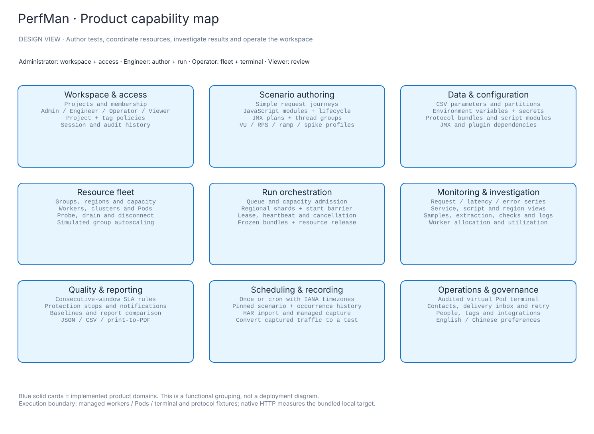
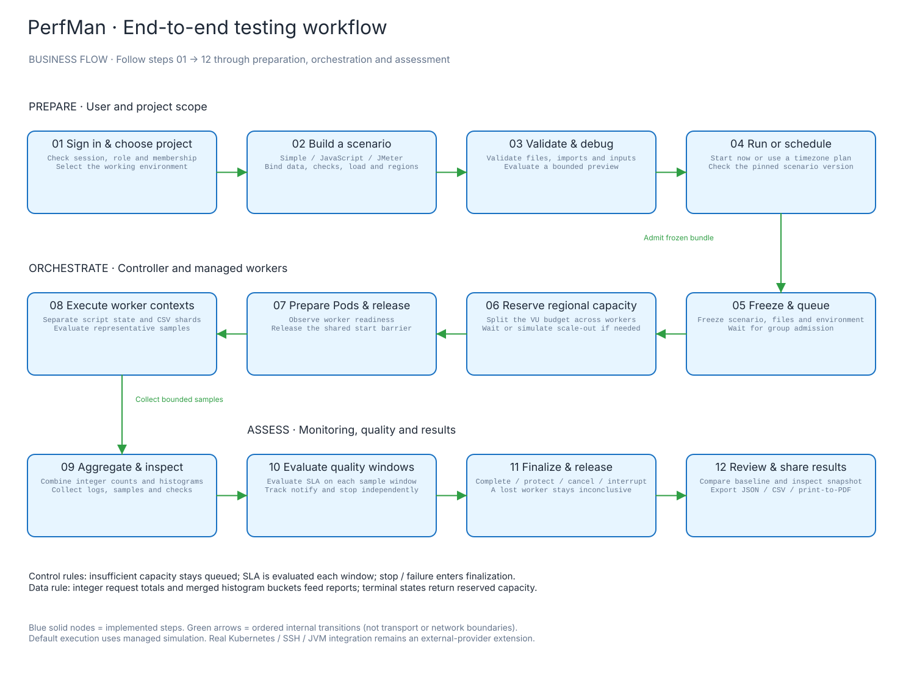
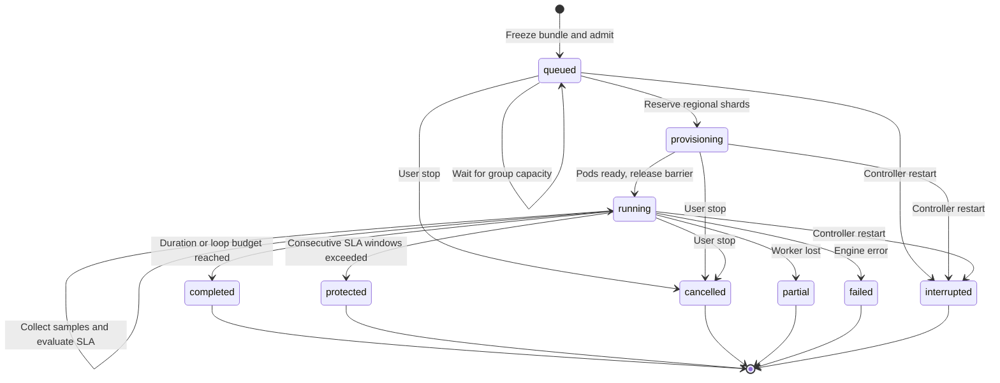

# Product and workflow design

These diagrams document the implemented Go Workspace. The module evidence is recorded in each `*-model.json`; execution-provider boundaries follow the [implementation matrix](../product/IMPLEMENTATION.md).

## Functional design



[PNG](feature-map.png) · [Editable Excalidraw](feature-map.excalidraw) · [Evidence model](feature-map-model.json)

The capability map groups features by the user's task. It is not a deployment diagram. Administrators manage workspace access, engineers author and run tests, operators manage the fleet and terminal, and viewers inspect authorized results. Project/tag policies further refine the three non-admin roles.

## End-to-end business flow



[PNG](business-flow.png) · [Editable Excalidraw](business-flow.excalidraw) · [Evidence model](business-flow-model.json)

Capacity shortages stay queued. After reservation, Pods prepare and the controller releases the start barrier. Independent worker contexts produce bounded samples; aggregate counts and histograms feed SLA windows and reports. Duration, stop, protection and failure all lead to finalization and release. A lost worker cannot silently produce a passed report.

## Run lifecycle



Finalization releases allocations, terminates managed Pods and freezes the report. Partial/interrupted/cancelled runs remain inconclusive. The [actual runtime architecture](../architecture/saas-runtime.svg) explains process and persistence boundaries.

## Regenerate and validate

Run from the repository root. Node.js is needed for diagram generation; `rsvg-convert` is optional for PNG previews.

```sh
node scripts/architecture/generate-product.mjs
node scripts/architecture/validate-excalidraw.mjs docs/design/feature-map.excalidraw docs/design/feature-map-contract.json
node scripts/architecture/validate-excalidraw.mjs docs/design/business-flow.excalidraw docs/design/business-flow-contract.json
rsvg-convert docs/design/feature-map.svg -o docs/design/feature-map.png
rsvg-convert docs/design/business-flow.svg -o docs/design/business-flow.png
```

## Earlier UI exploration

The [six-page wireframe sheet](solution-wireframes.svg) ([PNG](solution-wireframes.png)) is an earlier proposal. It is retained for design history and is not a screenshot or implementation claim. Use the [current screenshot gallery](../showcase/README.md) for the implemented interface. The [PTS review](../research/PTS_REVIEW_2026-11-08.zh.md) and [solution specification](../product/SOLUTION_SPEC.zh.md) preserve the original research and expanded requirements.
