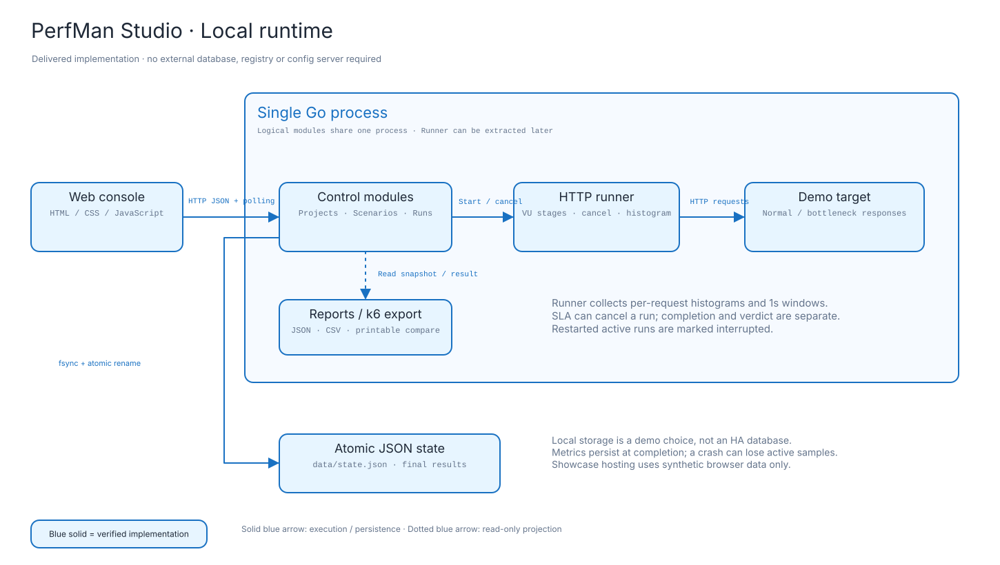
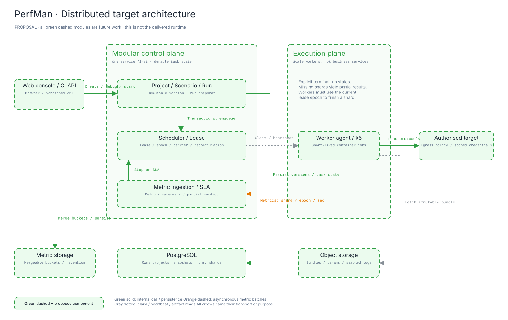

> 历史文档：当前运行版本已由 Go Workspace 替代，请查看 [实现矩阵](IMPLEMENTATION.md) 与 [启动说明](../../README.zh.md)。

# PerfMan 早期重设计记录：单机 HTTP 原型

> 范围已更新：本文保留早期审计与原型决策。正式目标为完整 Go 压测管理系统，见 [SOLUTION_SPEC](SOLUTION_SPEC.zh.md) 和 [PTS 逐项核查](../research/PTS_REVIEW_2026-11-08.zh.md)。本文的“暂不实现”不再代表当前需求范围。

设计日期：2026-11-08。面向个人或小团队维护、可运行、可解释、可展示的开源项目。

## 1. 产品决策

PerfMan 的主线应是“把业务流量变成可复现的性能证据”。用户创建场景，调试业务链路，设置负载与 SLA，运行后观察指标、定位慢请求，再用报告比较变更。项目管理、通知、账号、资源管理围绕这条主线服务。

首版采用一个模块化控制端、一个内置 HTTP 执行器和一个可重复的演示被测系统。未来把施压执行独立成 Worker，控制端的项目、场景和报告不必先拆成多个进程。**按施压规模拆执行平面，按业务边界组织控制端模块。**

这借鉴了本工作区 DBsSA/Haven 的交付方式：保留旧工程，新建可独立启动的轻量实现；用真实动作完成主要业务闭环；合成数据与外部能力边界明确；README、截图、架构图与验收记录共同支撑展示。

PTS 是产品路径的参照。本方案不会把公开功能说明推断成腾讯云内部实现；下面的租约、状态机和存储选择均是 PerfMan 自己的架构提议。参考 [PTS 产品页](https://cloud.tencent.com/product/pts) 与 [官方概述](https://cloud.tencent.com/document/product/248/87309)。

## 2. 仓库审计与证据

固定审计基线：

- PerfMan：`478e1ea98c1f3075a206f525f70829249d2d5cd3`。
- perfman-config-repo：`2e7f715762427d8d0fdf903df8f580dcfc57a244`。
- 对照工程：本地 `DBsSA/README.md`、`DBsSA/haven/` 及 `dbssa-web/README.md`。

| 已核实事实 | 证据 | 对设计的影响 |
| --- | --- | --- |
| 根目录有 14 个 `perfman-*-service` 模块目录，父 POM 当前只启用 discovery、config 两个模块 | `pom.xml` | “目录存在”与“产品功能完成”不能等同；普通 Maven 构建也不覆盖所有模块 |
| 认证有 Controller、Service、MyBatis 映射；压测、引擎、项目、环境、监控等目录主要为启动类和上下文测试 | 各服务 `src/main/` | 最大缺口是执行与报告闭环，继续增加服务名不会补上价值 |
| Java 1.8、Spring Boot 2.6.13，服务各自配置依赖版本 | 根与认证服务 POM | 后续 Java 方案应统一 BOM、升级支持版本、建立可重复构建；本次不宣称旧 Java 栈已升级 |
| SQL 已有项目、场景、任务、执行记录、报告、节点等表 | `resources/database/perfman_20240624.sql` | 可保留业务概念；任务状态目前只说明待执行/执行中/已删除，缺少运行事实语义 |
| 认证构建绑定 MyBatis Generator，开启 overwrite，配置指向开发数据库 | `perfman-auth-service/pom.xml` 与 `generatorConfig.xml` | 后续必须改成显式代码生成 profile；常规构建不能依赖个人数据库或重写生成代码 |
| JWT 在拦截器、切面中读取整个 Authorization；Controller 部分接口又截取 `substring(7)` | `TokenInterceptor.java`、`TokenAspect.java`、`AuthController.java` | Bearer 解析契约不一致，应统一认证过滤器，不直接迁移现有认证作为生产基础 |
| 验证邮箱和重置请求的实际路由与免鉴权列表不一致 | `WebConfig.java` / `AuthController.java` | 需要契约测试覆盖注册、登录、验证、重置整个路径 |
| 认证日志记录注册 DTO、无效 token | `AuthController.java`、`TokenInterceptor.java` | 后续清除凭据日志，身份领域与报告数据隔离 |
| Config Server 使用 SSH Git 地址、启动克隆和 Eureka | `perfman-config-service/src/main/resources/application.yml` | 初次演示依赖 Git 网络及 SSH 身份；本地版移除这条启动依赖 |
| 配置仓库有公共配置、auth/common 两个服务配置，包含数据库、Redis、邮件、JWT 等配置项，Actuator 为通配暴露 | `config-repo/*.yml` | 它是基础设施配置，不是已完成的运行时配置系统；敏感值改为环境引用，历史提交仍需另行处理 |
| auth 的 Config Data import 原写在 `spring.cloud.config.import` 下 | `perfman-auth-service/src/main/resources/bootstrap.yml` | 如果继续旧栈，按适用版本修正配置加载；不能把配置文件存在当作加载已验证 |

原 README 所列功能是项目愿景，部分 SQL 是设计资产。本次没有运行旧 Maven 服务、个人 MySQL、Redis 或邮件系统。旧配置与生成器不参与 Studio 构建。上述问题没有全部在旧 Java 路径修复；见迁移清单。

## 3. PTS 对标后的范围收敛

| 产品能力 | 展示版实际交付 | 下一阶段 | 本阶段明确边界 |
| --- | --- | --- | --- |
| 项目与场景 | 项目创建/切换，场景创建/编辑/复制/JSON 导入导出，版本冲突检查 | 项目角色和邀请 | 本地可信单人工作空间 |
| 场景编排 | 1–8 个顺序 HTTP 请求，GET/POST、头、JSON 体、预期状态码、顶层字段提取 | 分支、循环、CSV 参数、事务分组、脚本调试 | JSON 模式是声明式步骤编辑，不是任意脚本执行 |
| 调试 | 1 VU、单次业务链路、状态码与变量提取结果 | 受控响应预览、断点 | 不把调试结果混入正式报告对比 |
| 负载 | 恒定 VU、三阶段阶梯 VU、思考时间 | arrival-rate 开放模型、突增/耐久模型 | VU 不是 RPS，闭环模型会随响应变慢而降低吞吐 |
| 实际执行 | Go 内置执行器真实 HTTP 请求内置被测系统 | k6 容器 Worker | 本版仅内置目标，不连接任意外部地址 |
| 监控与保护 | 1 秒窗口 RPS/P95/错误率、请求分解、采样、连续窗口 SLA 停止 | 被测端 Prometheus/APM 关联，动态调压 | 未伪造 CPU、内存、地域监控 |
| 报告 | 执行与判定分开、快照、历史、对比、JSON、CSV、打印 | CI 门禁、基线审批、重复试验统计 | 有条件差异/提前停止时提示不能直接认定回归 |
| 引擎兼容 | 可导出可读 k6 脚本 | 首先接入 k6，再考虑 JMeter | 没有宣称 JMX/Locust 已接入；导出的 k6 脚本未在本机执行 |
| 分布式/多地域 | 提供架构、数据契约、故障行为 | Worker 租约、分片、资源池、K8s Job | 不以一台机器的 goroutine 宣称多节点或百万并发 |
| 展示入口 | 自托管本地实测版 + 在线浏览器合成演示 | 可部署控制端 | 在线入口不产生压测流量，不连接本机 API |

为何暂不实现所有协议、录制回放、云资源购买、独立告警/通知服务？这些会扩大依赖面，却不是证明压测闭环正确的前提。一个健康场景、一个可定位的瓶颈场景、一次可信停止和两份可解释报告，展示价值更高。

## 4. 页面与用户路径

导航为工作台、测试场景、运行记录、报告对比、执行资源、设计与演进。项目是过滤与归属边界。

1. 工作台选择“商城下单链路”，进入编辑，看到登录 → 商品 → 订单的顺序。
2. 登录请求提取 `token`；后续头使用 `Bearer {{token}}`。变量只在当前 VU 的当前事务内存在。
3. “保存并调试”运行一遍链路。失败则先修场景，不使用假成功数据继续演示。
4. 配置阶梯并发和 SLA，发起正式测试，进入运行详情。
5. 查看吞吐/时延双轴曲线、完整事务数、逐请求统计、事件与失败采样。
6. 运行“订单服务瓶颈复现”，观察订单慢响应、503 和 SLA 保护。
7. 在报告对比页选择两次运行。条件不同、基线为零、提前停止均有明确解释。
8. 修改场景后查看旧报告，确认旧版本和负载快照未变化；重启服务后结果仍在。

展示脚本与验收见 [DEMO.md](DEMO.md)。视觉设计使用冷灰工作台、钴蓝操作色、青色时延曲线、橙色保护状态与红色失败；大面积时间序列是主视觉，截图数据来自本地实测。设计约束见 [DESIGN.md](DESIGN.md)。

## 5. 当前实现架构

| 模块 | 责任与边界 |
| --- | --- |
| `studio/web/` | 无构建前端，调用同源 JSON API；界面不维护本地版业务事实 |
| `studio/http.go` | API 校验、单任务准入、项目/场景更新、导出；内置被测 API 提供正常和瓶颈响应 |
| `studio/model.go` | 领域对象、版本、种子数据、互斥访问、原子 JSON 保存、启动恢复 |
| `studio/engine.go` | 并发 VU、阶段调度、事务变量、请求超时/取消、分布统计、窗口 SLA 与终态 |
| `studio/cmd/perfman/` | 启动/停止 HTTP 服务，等待活动任务结束 |
| `web/demo.js` | 仅在线 showcase 使用的合成适配器；通过独立 `runtime.json` 明确选择，不因 API 异常静默降级 |

本地默认 Go 标准库 + JSON 文件，不要求 Node、MySQL、Redis、Eureka、Config Server 或 k6。编译时嵌入静态资源，一份二进制即可运行。采用 Go 是复用 DBsSA 交付方式，降低演示安装成本，并不表明原 Java 代码已经重构为 Go。

保留 Java 的后续实现也可行：用同样领域契约写一个 Spring Boot 控制端，把调度、场景、报告做包级模块，执行器仍独立部署。技术选择不能改变状态、指标和故障语义。

### 数据、恢复和限制

JSON 保存采用临时文件 → fsync → rename，修改在锁内串行执行。保存场景带 version 校验；运行前复制场景，后续编辑不能影响运行。创建任务必须先保存成功，才允许启动执行。终态保存结果。

活动窗口保存在内存中，进程异常终止可丢失本次指标；重启会把 running/stopping 标为 interrupted，判定为 incomplete，不自动续跑。JSON 文件不是数据库事务系统，不支持多进程共享写、跨实例锁或高可用。常规操作保留最近 200 次运行，最多 100 场景、30 项目。

本地是可信演示工作空间，没有生产身份与租户隔离。默认监听 loopback，仅允许 /demo-api/ 下的内置目标。修改监听地址不等于具备对外服务所需的身份能力。报告不保存请求/响应正文，但场景快照本身包含用户配置的头和请求体，因此请只填写合成凭据；生产方案改为 secret 引用并在执行时注入。

## 6. 指标与 SLA 的确定语义

- **请求数**：已得到响应/网络失败并完成记录的请求。主动取消及期限结束时尚在途的请求不计入完成数，也不把它们当作被测系统错误。
- **失败请求**：网络/超时、预期状态码不匹配、JSON 字段提取失败；错误率 = 失败请求数 / 完成请求数。
- **事务**：完整走完或明确失败的一次步骤链。事务失败后不执行剩余步骤；结束时被中断的部分事务不计入完整事务数。
- **RPS**：窗口用窗口请求数 / 实际窗口秒数；全程用完成请求数 / 实际执行秒数。事务吞吐不与请求吞吐混称 TPS。
- **时延**：请求发出至响应体读取完成，含网络等待；不含思考时间。1 ms 上界直方图，范围 0–10000 ms，按桶计数计算 P50/P95/P99，请求超时 3 秒。
- **窗口 P95**与**全程 P95**分别从对应直方图计算，不平均窗口的 P95。
- **保护**：至少预热 2 秒；随后每秒检查窗口，每窗至少 5 个请求；连续 3 个有效窗口的 P95 或错误率严格超过上限即取消。无数据或低样本窗口不推进计数。该规则主要展示机制，不代表生产环境通用的保护参数。
- **性能判定**：自然结束时对全程 P95、错误率判定 passed/failed；没有请求为 no_data；手动停止/中断为 incomplete；保护触发为 failed。
- **执行终态**：completed、protected、stopped、interrupted；执行 completed 仍可性能 failed。

闭环 VU 模型与开放到达率模型必须分开设计。将到达率交给未来 k6 adapter 时，同时记录 iteration arrival rate、实际 RPS、dropped iterations 和资源受限情况；不能把目标 VU 换个标签叫目标 RPS。参见 [k6 官方模型说明](https://grafana.com/docs/k6/latest/using-k6/scenarios/concepts/open-vs-closed/)。

导出的 k6 脚本是独立运行资产，使用平滑 ramping-vus；本地使用三段阶梯，形状不完全相同。导出保留最终阈值判定，不复刻本地连续窗口的停止逻辑。导出文件注释与演示说明写明差异。

## 7. 下一阶段目标架构：理论可行的分布式设计

下面全部是**提议**，不表示本次已交付。

控制端先保持一个服务。PostgreSQL 同时存业务状态、任务队列与 outbox；调度器用事务和行锁领取待处理任务，第一阶段无需 Redis 队列、Kafka 或独立注册中心。执行平面使用 k6 容器 Worker，之后才增加 JMeter adapter。Kubernetes 已有需求时可评估 [k6-operator](https://grafana.com/docs/k6/latest/testing-guides/running-distributed-tests/)，不要同时维护自研完整 Operator 和另一套调度事实。

### 领域实体与所有权

| 实体 | 关键字段 | 不变量 |
| --- | --- | --- |
| Project | id, name, members | 所有资源归属项目，鉴权先校验归属 |
| Environment | id, base_url, allowed_hosts, secret_refs | 部署环境与被测环境分开；密钥引用不进入快照明文 |
| ScenarioVersion | scenario_id, version, DSL/hash, engine/version | 版本只增不改，发布后不可变 |
| Artifact | id, hash, object_key, size, content_type | 以内容哈希校验；参数文件/脚本设置大小与权限 |
| Run | id, project_id, version, load_snapshot, SLA_snapshot, env_digest, state, verdict | 用户点击启动时冻结全部执行依据 |
| Shard | run_id, shard_id, target_load, lease_epoch, owner, expires_at, state | 任一时刻只有当前 epoch 有权提交终态 |
| MetricBatch | run_id, shard_id, epoch, seq, time_window, counters, histogram | 去重键固定；旧 epoch/重复 seq 不重计 |
| Report | run_id, version, coverage, metrics, missing_shards, quality | 缺分片/缺指标必须标记 partial，不静默通过 |
| RunEvent / Outbox | run_id, type, payload, attempt, next_at | 状态先落库，副作用可重试、有幂等键 |

### 生命周期与调度

`CREATED → QUEUED → PREPARING → RUNNING → DRAINING → COMPLETED`。异常终态为 FAILED、CANCELLED、TIMED_OUT、PARTIAL。质量判定独立：PASS、FAIL、INCONCLUSIVE。SLA 触发原因作为 stop_reason，不借用删除状态。

- 同一 Idempotency-Key 的启动请求只创建一个 Run。PostgreSQL 中事务化写入 Run、分片和 outbox。
- Scheduler 分配可满足引擎版本、地域标签、容量和出站目标限制的 Worker。先资源准入，再生成 start barrier。
- Worker 拉取已签名/鉴权的不可变 bundle，校验哈希，READY 后等待统一 start_at。未在期限内就绪的分片不能无提示降低负载。
- 建议初始租约 15 秒、每 5 秒心跳，参数需故障实验调优。租约续期、接管均校验 epoch；重复领取不能重复施压。
- 施压是外部副作用，不可假定恰好一次。失联旧 Worker 可能仍发送流量；Worker 必须在本地 lease deadline 到期自行退出，并限制执行 hard deadline。控制端在旧租约确定过期前不重发相同分片；运行中分片原则上失败为 PARTIAL，不透明重放业务请求。
- stop 命令先记录，再通过心跳/命令通道传播；取消未启动任务、终止引擎进程、等待宽限期后强制退出。展示 stop_requested_at、last_heartbeat、effective_stop_at，不把“收到停止按钮”当作全部流量已结束。
- 每个 run/shard 有全局时限、资源限额、幂等终态与对账作业，控制端重启可以根据持久事实恢复调度。

### 分布式指标与报告终结

先求和请求/错误/字节计数，再合并可兼容的时延直方图，最后计算分位。**不要平均节点 P95，也不要平均错误百分比。** 不同桶边界必须拒绝或正规转换。Prometheus 的 [histogram/summary 说明](https://prometheus.io/docs/practices/histograms/) 可作为实现依据。

批次包含事件窗口、收集时间、epoch 和序号。接收端持久去重，高基数标签受控，只保留 run/shard/step 等稳定维度，不把完整 URL、用户 ID、token 做标签。对乱序和迟到使用有界 watermark 与终结宽限期，迟到修正要有报告版本。Worker 时钟同步并用单调时钟计算请求耗时。

所有分片结束且指标补齐后才生成完整报告；未补齐则 PARTIAL/INCONCLUSIVE。全局 SLA 基于合并有效窗口，局部保护可独立触发紧急停止；资源耗尽与被测错误分开展示。

先用 PostgreSQL 保存低量窗口和报告；规模增长后引入 Prometheus-compatible 或 ClickHouse 等指标存储，按实际查询与基数选择，不把多套数据库当作首版必要依赖。原始响应日志采样后进入对象存储，受控留存和脱敏。

### 引擎适配边界

`Validate → Prepare → Start → Observe → Stop → Collect` 是契约提议。每个 adapter 声明支持协议、负载模型、变量/断言语义、版本、可用指标与计量单位。不把 k6、JMeter、Locust 的不同事务和 percentile 语义直接混合。首个 adapter 跑通后再扩展第二引擎。

## 8. 配置仓库的处置

`perfman-config-repo` 保留为旧 Spring 配置与未来部署配置的上下文。后续应将配置中的敏感项改为 `${PERFMAN_*}` 引用，并收窄管理端点（本次尚未修改旧配置）；历史里的真实值不会因此消失。如这些值曾用于真实环境，应撤换对应凭据。本次没有连接外部系统验证其有效性，也没有重写 Git 历史。

四类配置分开：

1. **部署配置**：监听、数据库、对象存储、队列、日志；环境变量/启动配置注入，secret 来自受控存储。
2. **被测环境**：base URL、目标允许列表、公共变量、secret references；属于项目业务数据。
3. **场景版本**：步骤、脚本、参数和引擎版本；不可变资产。
4. **运行快照**：确切场景版本、环境脱敏摘要、参数文件哈希、负载、SLA、引擎版本；用于复现。

GitOps 真有多个部署环境需要时，再加独立配置发布流水线：审查 → 校验 → 版本化 → 启动读取。Git 不可用不应阻止已准备好 bundle 的在途任务结束。运行中不能热更负载/凭据而不留下版本事件。普通业务对象不放入配置 Git 仓库。

旧 Java 配置加载请按选定版本核验 `spring.config.import`，参考 [Spring Cloud Config 官方文档](https://docs.spring.io/spring-cloud-config/reference/client.html)；官方当前文档不替代旧 2021.x 版本的实际兼容测试。

## 9. 演进顺序与完成标准

| 阶段 | 交付 | 完成标准 |
| --- | --- | --- |
| 本次 v0.1 | 独立可运行演示、设计文档、架构与接口、实测与截图 | 一条健康链路通过；一条瓶颈触发停止；快照/并发准入/持久化有测试 |
| v0.2 | PostgreSQL、执行器进程独立、k6 adapter、Compose | 杀 Worker/杀控制端、过期租约、重复启动/上报可正确恢复或标 partial |
| v0.3 | 受控外部目标、环境 secret、CSV 参数、开放模型、CI API | 校验真实目标的授权、限额、重定向/DNS 出站边界；对照引擎原生报告一致 |
| v0.4 | 资源池、K8s Job、多地域、团队权限、监控关联 | 有真实多节点故障实验和负载基准，再公布容量与资源建议 |

不提供未经测量的百万并发、可用性或资源成本承诺。容量需要固定硬件、引擎版本、连接复用/TLS/响应体、被测延迟、脚本、负载模型和监测开销，并发布瓶颈与误差。所谓理论可行，体现在任务与指标契约、失效行为和扩容路径自洽；所谓可展示，体现在首版真的跑完闭环。
