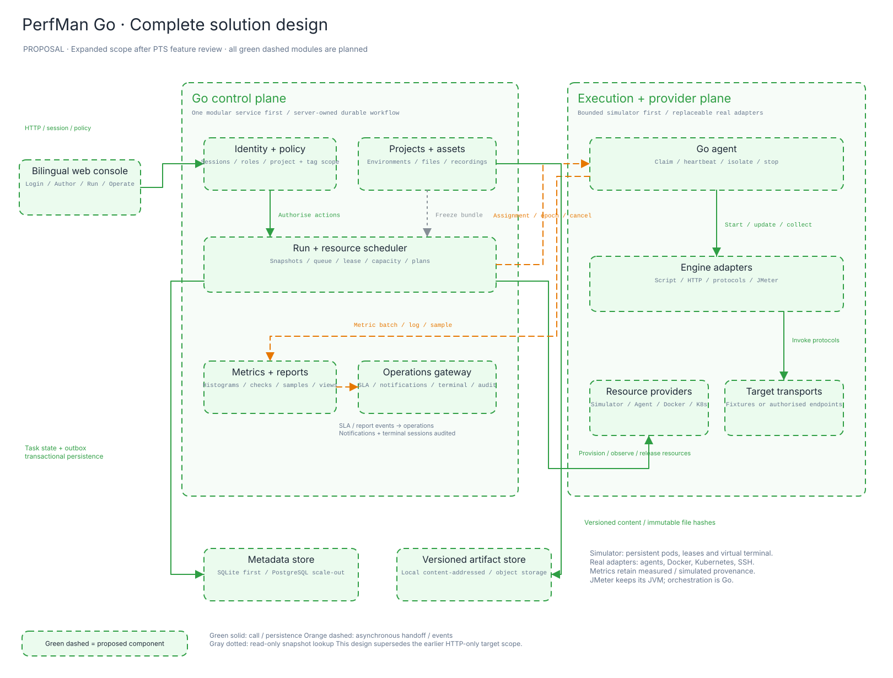

> 需求与目标设计。当前已实现的行为、模拟边界及尚需外部适配的部分见 [实现矩阵](IMPLEMENTATION.md)。

# PerfMan Go：完整压测管理系统设计

状态：**扩大范围后的目标设计；尚未全部实现**。2026-11-08。

本设计替代之前“单机 HTTP 展示版即可”的范围。新的交付目标是一个可独立运行的压测管理系统：用户登录、权限、项目、配置、录制、三种场景编辑、资源接入/分组、调度、弹性 Pod、协议执行或受控模拟、监控、SLA、通知、报告与运维终端，都能在同一系统中形成完整流程。

逐项官方核查见 [PTS_REVIEW](../research/PTS_REVIEW_2026-11-08.zh.md)，其中将“官方事实”“PerfMan 设计”“实际实现状态”明确分开。

## 1. 产品原则与交付定义

功能覆盖以用户截图目录和新增管理要求为准，不将难的项目悄悄移出范围。允许模拟外部资源、云平台、网络连接和施压能力；模拟不得替代项目/场景/任务等管理流程的真实实现。

- **管理事实真实**：Go 服务端认证与授权、对象校验、持久化、版本、文件引用、调度任务、告警、报告、审计可操作并可恢复。
- **外部边界可替换**：模拟 Provider 与真实基础设施 Provider 使用同一契约，模拟 Engine 与真实引擎也使用同一事件与报告契约。
- **结果来源明确**：资源列表标 provider，报告标 measured/simulated，混合来源不得汇总成一个“实测”容量结论。
- **失败是产品功能**：离线节点、容量不足、缺文件、脚本错误、超时、Pod 失败、告警投递失败都能触发、诊断、处理。
- **运行中可管理**：排队/取消、RPS 调整、日志过滤、节点排空、Pod 详情、终端会话与结束清理都有后端状态。
- **多语言完整**：中文和英文覆盖登录、导航、表单、错误/空态、日志事件说明、帮助、报告；用户内容保持原文。

完成标准不是“截图看起来像控制台”，而是新机器启动后，不修改源码即可按第 12 节跑完完整路径，并通过测试矩阵。

## 2. 页面结构

```text
登录 / 首次初始化 / 密码恢复
└─ 工作空间（项目选择、全局搜索、语言、通知、用户菜单）
   ├─ 工作台
   ├─ 项目管理
   │  └─ 概览 / 成员 / 标签 / 项目设置
   ├─ 测试场景
   │  ├─ 简单模式：请求编排 / 文件 / 负载 / SLA / 高级配置
   │  ├─ 脚本模式：文件树 + 编辑器 + 模板 / 文件 / 负载 / SLA / 高级配置
   │  └─ JMeter：入口 JMX / 依赖 / 线程组 / 压力覆盖 / SLA / 日志
   ├─ 流量录制
   │  └─ 会话 / 导入 / 请求筛选 / 生成场景
   ├─ 配置管理
   │  ├─ 参数文件 / 协议文件 / 请求文件 / 引擎依赖
   │  └─ 环境 / 变量 / 加密变量
   ├─ 运行与计划
   │  ├─ 任务队列 / 运行记录
   │  └─ 定时任务 / 执行历史
   ├─ 压测报告
   │  └─ 概览 / 服务 / 检查点 / 脚本快照 / 多维分析 / 施压机 / 采样
   ├─ 资源与调度
   │  ├─ 资源组 / 节点 / 集群 / Pods
   │  ├─ 调度总览 / 容量 / 组监控
   │  └─ 资源详情 / 日志 / Web Terminal
   ├─ 告警管理
   │  └─ 联系人组 / 通知渠道 / 告警历史 / 发送记录
   └─ 系统管理
      └─ 用户 / 角色与策略 / 标签 / 集成 / 审计 / 错误诊断
```

“设计与演进”“开源仓库”不进入业务导航；方案与开发信息留在仓库文档。不同角色只显示可见模块，但隐藏按钮不代替后端授权。

## 3. 主要页面如何设计

### 3.1 登录与首次使用

登录页左侧为产品标识和简短用途，右侧邮箱/用户名、密码、语言、登录。首次启动进入初始化：创建管理员、设置工作空间名、时区，选择“本地模拟资源组”或已有节点接入。预置账户仅由显式 seed profile 提供，不与正常初始化混用。

登录成功进入工作台，展示我的项目、进行中任务、等待任务、资源容量、最近失败与需要处理的告警。空状态给出“创建项目→接入资源→建立场景”入口；已经初始化后不再插入推介或架构说明。

### 3.2 场景创建与三种编辑器

先选择项目、名称、模式。共同页头显示保存状态、版本、环境、调试、保存、保存并运行。共同页签为编排、文件、负载、SLA、高级配置；切换页签保留草稿。

**简单模式**：左栏为有序请求树，主区为请求编辑；下方展示可用变量。请求内部页签为参数、认证、头、正文、提取器、检查点、设置。支持插入请求、思考时间、条件/循环等步骤。变量标来源（环境/CSV/前置提取/运行元数据）。JSONPath/正则可在调试响应上试用。

**脚本模式**：左侧脚本/公共模块树并显示入口权重；中间代码编辑器，有行号、搜索、语法错误；右侧协议模板与 API 说明；底部为校验/调试输出。提供 HTTP、gRPC、Protobuf、WS、SQL、Socket.IO、TCP/UDP、Redis 模板。模板必须能编辑并影响运行，不能只复制一段说明。文件树中的每个入口有文件名、内容、权重；公共模块权重为零。

**JMeter 模式**：主区为文件表、主 JMX 单选、解析结果与依赖检查；次区为线程组表和覆盖预览。并行/串行、循环、VU/RPS、递增、CSV split、插件、日志选项分别编辑。显示引擎/JDK/plugin 版本。执行方式由 engine adapter 决定，不能把 JMX 当成普通 HTTP 表单。

简单模式切换脚本不原地破坏可视化草稿：创建新版本并保留转换来源。用户可回看旧简单版本；不宣称任意脚本可无损逆向生成可视化步骤。

### 3.3 负载与资源计划

左侧编辑模型：恒定/阶梯/突增 VU、恒定/阶梯 RPS、总时长、起始值、最大值、递增步数/时长、思考时间；右侧是可交互目标曲线。下方选择资源组、公网/私有网络、VPC/子网、地域与比例、资源预算与自动伸缩策略。

“预检资源”返回按地域的目标负载、节点数/Pod 数、引擎、配额、可达性、缺口与预计准备步骤。用户看到的是计划。只有 Pod Ready 和屏障放行后才进入施压。

RPS 模式在运行页可调整目标，服务端验证范围后记录 LoadRevision，将预算按原分配规则重新下发。记录目标、已下发、已确认、实际速率与 dropped/欠压，不能拖完滑块就宣称已经达到压力。

### 3.4 资源接入、资源组与调度

资源列表列出名称、provider、类型、地域、所属组、引擎能力、容量、连接/心跳、当前分配和操作。新增表单包含地址、认证引用、标签与容量声明。探测结果是独立对象，展示 TCP/认证/agent/engine 各阶段结果；“配置保存成功”与“连接成功”分开。

资源组详情包含：概览、成员、容量与弹性、任务、监控、事件。节点操作：探测、启用、排空、禁用、终端。排空后不接新任务，既有任务按策略结束。删除有依赖与活跃会话检查。

调度总览以 run→region→shard→worker→pod 展示树与时间线，旁边是待执行队列与组容量。每个分片显示 lease owner、epoch、心跳、启动/停止/清理状态，详情可定位“为什么没启动”。

Pod 详情包含 metadata、容器/镜像/资源、事件、日志、关联分片、终端与保留/回收状态。模拟 provider 产生的 Pod 也是真实的领域对象，跟随任务创建、就绪、运行、结束和清理。

### 3.5 Web Terminal

从节点或 Pod 详情打开，显示目标、当前用户、provider、连接状态、会话剩余时间与关闭。真实 SSH 与 Kubernetes exec 是两个 transport，不混为一谈。

模拟终端使用服务端虚拟文件系统与进程表，支持 `pwd`、`ls`、`cd`、`cat`、`ps`、`env`、`tail`、`top`、`help` 等受控命令，命令结果从当前资源/任务状态产生。例如运行中的 Pod 能看到实际关联的 run 配置与引擎日志；任务结束后进程状态改变。它不调用宿主 shell，也不会输出一段与资源状态无关的固定假文本。

真实 transport 使用临时凭据和 WebSocket 字节流，记录会话创建/关闭和必要审计，凭据不经浏览器存储。终端权限独立于普通执行/只读报告权限。断连、过期、节点删除与退出会话均要回收。

### 3.6 报告与监控

一个 Run 的实时与历史视图共用布局，结束后停止刷新并展示完整性。页头显示场景版本、引擎、环境摘要、执行者、时间、资源组、来源、执行状态与性能判定。

- 概览：目标/实际 VU 或 RPS、请求/消息/事务、平均/分位时延、错误、流量、目标曲线与实际曲线。
- 服务明细：按 step/service/protocol/status 分组，支持筛选与钻取。
- 检查点：总数、通过/失败、失败率、时间序列、关联请求与失败原因，独立于请求结果。
- 脚本快照：入口、公共模块、hash、环境脱敏摘要、负载/SLA、文件版本与引擎版本。
- 多维分析：选择 metric、aggregation、region、script、service、worker；添加/删除图表并保存布局。
- 施压机：任务分片、Pod/节点指标、CPU/内存/网络、引擎/用户日志、心跳与资源限制。模拟数据来源必须能看见。
- 请求采样：按错误、状态、请求名与耗时筛选；详情显示脱敏头/正文、检查结果和耗时瀑布。

报告基线是固定 report version。比较前检查场景、环境、引擎、负载签名与完整性；基线为零时使用绝对差，不显示无穷百分比。PDF、CSV、JSON 均包含来源与未完成原因。

### 3.7 配置、录制、计划与告警

文件库按项目管理类型、版本/hash、大小、创建者和引用场景；支持预览/下载/关联/解除关联。场景引用中的文件不能直接删除；运行引用的是不可变文件版本。

环境管理使用键值表、加密开关和说明。加密值保存后用占位符表示；“未更改”不被误保存成星号。切换环境能改变运行注入值，报告只保存脱敏摘要与 secret version。

录制页提供录制会话、HAR/可选 GoReplay 导入、过滤、脱敏和生成场景。本地模拟录制通过内置合成业务站产生真实请求记录；其他网站录制需要用户安装的扩展/代理，普通网页不能声称全局监听浏览器。生成的场景可继续编辑、调试和运行。

计划页支持一次/按日/按周/cron、IANA 时区、结束时间、下一五次预览、重叠和错过策略、联系人。绑定固定场景版本；这比强制锁住整个场景更适合开源实现，但属于明确的产品差异。

告警将 SLA、停止动作、通知投递分成三个事实。用户可看到规则/触发值、关联运行、停止是否完成、渠道投递结果、重试与处理人。模拟邮箱/Webhook 接收箱可完整查看消息；真实发信/回调必须配置真实渠道并记录实际响应，不能都写成“已发送”。

## 4. Go 架构



### 部署单元

| 单元 | Go 责任 | 初次运行 |
| --- | --- | --- |
| `perfman server` | HTTP API、身份、项目、资产、计划、调度、指标汇聚、告警、终端网关；内嵌前端 | 必需 |
| `perfman agent` | 资源注册/心跳、执行分片、管理引擎进程、采集、取消、日志/终端代理 | 模拟模式可作为同进程组件；真实资源独立进程 |
| 引擎容器 | 原生脚本/HTTP、多协议 adapter、JMeter 进程或可选 k6 adapter | 模拟 engine 与本地 HTTP 可以内置；真实扩展独立 |
| 元数据与资产存储 | SQLite WAL + 本地内容寻址文件，单节点；PostgreSQL + 对象存储用于多实例 | 默认不强制外部服务 |
| 可选观测集成 | Prometheus exporter/remote write、Grafana/APM connector | 不阻断内部报告生成 |

单机安装不需要先部署十几个微服务。API/Scheduler/Metric/Alert 是包级模块，有各自接口与存储边界；未来负载增加时优先独立 agent、指标写入和执行容器。HTTP 前端与命令行使用相同 API。

### 建议 Go 包边界

```text
cmd/perfman/
internal/
  identity/ policy/ audit/
  project/ environment/ secret/
  artifact/ recorder/ scenario/ compiler/
  load/ scheduler/ lease/ plan/
  resource/ provider/ agent/ terminal/
  engine/ protocol/ dataset/ check/
  metrics/ sampling/ report/ dashboard/
  alert/ notification/ integration/
  store/ api/ locale/
web/
  locales/ auth/ workspace/ scenarios/ resources/ reports/ settings/
migrations/ fixtures/ examples/ tests/
```

无业务代码通过全局 state 任意改其他模块的数据；写入必须走领域操作和事务。API 不是把所有内容整块 GET/POST 的共享 JSON 状态，列表分页、详情与时序查询分开。

## 5. 模拟如何成为 solution 的组成部分

模拟由明确 Provider/Engine 决定，用户创建真实项目和任务，再选择模拟资源组运行。浏览器展示服务端返回的状态，不在 localStorage 中自行生成运行结果。

### ResourceProvider

```go
type ResourceProvider interface {
    Probe(ctx context.Context, ref ResourceRef) (ProbeResult, error)
    Provision(ctx context.Context, spec AllocationSpec) (Allocation, error)
    Observe(ctx context.Context, id string) (ResourceObservation, error)
    Release(ctx context.Context, id string) error
    OpenTerminal(ctx context.Context, target TerminalTarget) (TerminalStream, error)
}
```

初始实现：SimulatorProvider。可扩展：AgentProvider、DockerProvider、KubernetesProvider、SSHProvider。接口为设计草案，不表示当前已存在。

模拟资源的状态为 requested→provisioning→ready→draining→released，异常有 error/offline。Pod 状态 pending→creating→ready→running→succeeded/failed→deleting→deleted。每个状态有事件、时间、版本和受控故障注入。

### EngineAdapter

```go
type EngineAdapter interface {
    Validate(ctx context.Context, bundle Bundle) (ValidationResult, error)
    Prepare(ctx context.Context, assignment Assignment) (PreparedRun, error)
    Start(ctx context.Context, prepared PreparedRun) (Execution, error)
    UpdateLoad(ctx context.Context, executionID string, rev LoadRevision) error
    Stop(ctx context.Context, executionID string, reason StopReason) error
    Collect(ctx context.Context, executionID string) (ArtifactManifest, error)
}
```

协议定义、脚本内容和断言不是装饰：模拟执行必须解释支持的计划/脚本语义，并根据输入与 fixture 得到不同结果。对于未支持的任意 JS/JAR/JMX 元件，校验应明确指出不支持，不能无论内容是什么都生成同一条成功曲线。

本地模拟允许构造百万级**逻辑负载计划**，采用有限事件推进和采样计算，内存/CPU 有限。目标吞吐、实际模拟吞吐、配额不足、队列等待、资源扩容都由相同负载/资源模型驱动。不得把逻辑百万负载记为本机百万连接实测。

协议模拟保留其独特语义：gRPC 的 method/status、WS/Socket.IO 的连接与事件、SQL 的结果集/影响行、Redis 的命令、TCP/UDP 的字节/消息与超时、Protobuf 的描述符与序列化。至少每种协议有通过、断言失败、连接/超时三条可测试路径。

故障注入包括节点探测失败、Ready 超时、Pod 崩溃、心跳丢失、目标慢响应/错误、指标延迟/重复、渠道发送失败。界面可选择预置故障用于验证，不隐藏在源码常量里。

## 6. 领域与数据库设计

| 领域 | 主要记录 | 核心约束 |
| --- | --- | --- |
| 身份权限 | users, sessions, roles, policies, bindings | 会话可撤销；项目/标签授权默认拒绝；身份凭据独立存储 |
| 项目与配置 | projects, members, environments, env_versions, secrets, tags, tag_bindings | 所有资源有 project_id/org_id；加密 secret 不出现在普通查询 |
| 资产与场景 | artifacts, artifact_versions, scenario_versions, script_entries, references | 内容寻址；场景/运行引用不可变版本；删除先检查引用 |
| 录制与计划 | recording_sessions, recorded_requests, schedules, schedule_occurrences | 输入过滤/脱敏；计划触发以 occurrence_key 幂等 |
| 资源与调度 | groups, resources, clusters, allocations, pods, runs, shards, leases | 容量事务预留；epoch fencing；状态转移 CAS |
| 观测与报告 | metric_batches, window_projections, samples, check_results, reports, dashboard_layouts | 去重键固定；源/维度/单位明确；报告可标 partial |
| 告警与运维 | alert_rules, alert_events, contacts, deliveries, terminal_sessions, audit_events, outbox | 动作与投递独立；重试幂等；终端有权限与生命周期 |

SQLite 默认单控制进程 WAL 模式；外键、唯一索引与事务真正启用。多控制实例迁移到 PostgreSQL 之前不能声称分布式高可用。文件内容放内容寻址目录，不将大文件/海量日志塞进单份 JSON 状态。

任务启动事务：校验权限/版本/依赖→冻结脱敏快照→创建 Run+ShardPlan+Outbox→提交。Scheduler 再消费持久待办，不能“Go goroutine 已启动而数据库保存失败”。

运行快照保存：ScenarioVersion、环境版本/脱敏摘要、secret version refs、文件 hashes、引擎/JDK/plugin 版本、LoadSpec、SLA、资源组/地域、网络/超时/采样策略、执行者。运行所需的密钥短时解析注入，不把解密值写进快照。

## 7. 调度、资源组与弹性

### 状态与分配

Run 状态：created→queued→planning→provisioning→ready→running→draining→finalizing→completed。终态还包括 failed/cancelled/timed_out/partial。Verdict 单独为 pass/fail/inconclusive；stop_reason 为 user/SLA/timeout/node_lost 等。

调度策略：以项目配额和优先级入队，组内按地域/网络/引擎标签/可用容量筛选节点。先锁定配额，再申请 Allocation 和 Pod。整数 VU/RPS/脚本权重/地域比例采用总量守恒分配；组合形成 shard，页面可以预览每项预算。

各 Pod 上报 READY 后，在屏障处确认全部必要分片可运行，并下发 start_at。资源不足时排队或按显式策略失败，不无提示降低压力。运行时每个窗口有目标、已分配、实际和欠压。

### 租约与故障

- assignment 包含 run/shard/epoch/owner/deadline；任务领取和续约使用 CAS。
- Worker 在本地租约过期前自停，旧 epoch 不能提交有效终态/指标。
- 不假设网络侧恰好一次。失联 Worker 仍可能发流量；必须等待旧 lease 过期，且执行中分片默认不透明重试业务操作。
- 控制端恢复后从持久状态对账资源和任务；未确认的副作用保留 unknown/partial，不自动 pass。
- 取消覆盖 queued、provisioning、running、finalizing。停止命令有 requested/acknowledged/effective 三个时间，不把停止按钮响应当成流量结束。
- 资源回收使用独立幂等清理任务。清理失败进入 orphaned/retry，界面可见且配额不能提前释放成无限超卖。

### 动态调压和扩缩

LoadRevision 带版本号。先计算新预算与资源缺口，扩容就绪后再提高有效压力；降低压力先下发预算，再回收空闲 Pod。各 Worker ACK 对应版本，页面展示传播状态。达到组上限时返回欠压原因，不显示“目标已实现”。

资源监控须展示逻辑调度量与 CPU/内存/网络观测的区别。SimulatorProvider 的 CPU/网络曲线由模拟工作负载模型推导并标模拟；真实 provider 使用容器/cgroup/agent 计量。

## 8. 指标、检查点与报告正确性

先累计/合并原始计数和兼容直方图，再计算百分位与百分比。错误率应请求失败数/总请求数；检查点失败率是检查点失败数/检查点执行数，两者独立。WS/Socket.IO 另外定义 connection/message/event 指标；事务不等同请求。

MetricBatch 包含 source、run、shard、epoch、seq、event window、counter delta、histogram schema、step/script/region 等稳定维度。以 `(run, shard, epoch, seq)` 去重。迟到批次有 watermark 与宽限期，丢分片/缺数据为 incomplete/partial，修正报告提升 report version。

SLA 的指标、作用域、聚合、比较符、阈值、窗口、连续次数、最小样本、预热、动作均显式。每次评估留 RuleEvaluation；触发留 AlertEvent；停止与通知各走 Outbox。无数据不是达标。

采样与日志有脱敏、字节/条数/速率上限，展示丢弃数。请求详情的耗时瀑布由实际阶段计量或模拟 fixture 生成，绝不将模拟阶段耗时显示为真实网卡观测。

## 9. 多语言与权限

前端资源使用稳定 key，例如 `run.state.provisioning`、`resource.probe.failed`。Go 返回 `code + params + traceId`，前端按语言渲染；事件持久化也是 code/params，不把中文完整句子作为业务枚举。英文和中文 key 集合通过测试比对。

时间以 UTC 存储，计划使用 IANA timezone。界面按用户语言和时区格式化。切换语言不重置路由、表单和查询；用户名、项目名、脚本、协议内容不翻译。

预置角色：

| 角色 | 权限 |
| --- | --- |
| Workspace administrator | 用户/策略、资源与全局设置、所有项目 |
| Project administrator | 指定项目成员、配置、场景、计划、告警、报告 |
| Test engineer | 指定项目编排、调试、启动/停止、分析；不读取 secret 明文 |
| Resource operator | 资源接入、排空、组/Pod/终端；不管理账号或无关项目配置 |
| Observer | 指定项目只读报告与可见配置，无执行、编辑、终端权限 |

资源级/标签级策略在服务端读写和关联资源时统一校验；默认拒绝，显式 deny 优先。SSH/终端、真实出站测试、secret 修改属于独立 action。用户禁用/角色撤销立即影响会话操作。

## 10. 配置仓库和旧 SSM 的迁移

Go 服务接管业务 API，旧 Java 工程、Maven 与旧数据库脚本已从当前分支移除，需要时从 Git 历史查阅。无需将 Eureka/Config/Auth/Logging/Notification 等旧服务一比一翻译成同样数量的 Go 微服务。

`perfman-config-repo` 只属于历史部署上下文，当前版本不读取或依赖该仓库。进程配置由本仓库 `.env.example` 说明，运行时使用环境变量；项目环境、场景、运行快照均进入业务数据库。真实密钥不复制到仓库或前端。

迁移清单：导出现有用户/项目/场景元数据→字段映射/校验→导入新库→补齐版本与来源→重新验证认证与权限。旧 JWT/Redis token 不自动可信迁移。旧 SQL 的任务/报告实体补齐状态、快照、分片、质量和文件引用。

部署配置允许环境变量和配置文件，启动校验并展示可读错误。没有外部 Redis、消息队列和 Config Server 时，单机方案仍可运行。备份应包含数据库、资产、必要加密主密钥；只备份 JSON/数据库而丢密钥不能恢复加密环境变量。

## 11. API 与事件边界

API 使用 `/api/v1`，列表分页，细粒度授权，OpenAPI 契约。建议资源族：

- `/auth/session`、`/users`、`/roles`、`/policies`、`/audit`。
- `/projects/:id`、`/environments`、`/artifacts`、`/tags`。
- `/scenarios`、`/scenario-versions`、`/validate`、`/debug-runs`。
- `/recordings`、`/recordings/:id/requests`、`/recordings/:id/convert`。
- `/runs`、`/runs/:id/events`、`/stop`、`/load-revisions`、`/shards`。
- `/resources`、`/resource-groups`、`/clusters`、`/pods`、`/probe`、`/drain`。
- `/terminal-sessions`（授权创建）与 WebSocket 连接、续租和关闭。
- `/schedules`、`/schedules/:id/preview`、`/occurrences`。
- `/metrics/query`、`/reports`、`/reports/:id/export`、`/dashboard-layouts`。
- `/alert-rules`、`/alert-events`、`/contacts`、`/deliveries`、`/integrations`。

返回稳定错误码和 requestId，不将底层堆栈或密钥返回浏览器。实时数据可先短轮询/SSE，终端使用 WebSocket；agent 通道可采用鉴权 HTTP 长轮询/流式上报，保持 transport 可替换。

核心事件：RunCreated、CapacityReserved、PodRequested、WorkerReady、RunStarted、LoadRevisionAcked、MetricBatchAccepted、RuleTriggered、StopRequested、ShardFinished、RunFinalized、DeliveryAttempted、ResourceReleased、TerminalOpened/Closed。

## 12. 端到端验收路径

| 路径 | 必须成立的动作与结果 |
| --- | --- |
| 首次使用 | 启动→建管理员→登录→切英文→创建项目→添加资源/模拟节点→探测→创建资源组→就绪 |
| 简单模式 | 建环境与 CSV→编排登录/提取/下单→调试→负载/地域/SLA→资源预检→运行→监控→报告→导出 |
| 脚本与协议 | 每个协议使用模板→修改输入→语法/依赖检查→调试→模拟或真实 adapter 执行→协议专属指标/日志→结果 |
| JMeter | 上传 JMX/CSV/JAR→解析→入口/线程组/限速→校验依赖→调试/运行→JTL/采样/断言日志→报告 |
| 录制 | 录制内置业务或导入 HAR→过滤/脱敏→生成场景→调试→执行→结果 |
| 调度 | 多地域分片→Pod 生命周期→屏障→心跳→调压→节点故障→partial/失败→资源清理→组容量恢复 |
| 运维 | 从运行找到 Pod→看日志/监控→开终端→查看 run 配置与进程→停止任务→日志/进程状态改变→会话审计 |
| 计划与通知 | 固定场景版本→预览触发→到期执行→生成结果→通知收件箱→发送失败重试→历史可查 |
| 权限 | 观察者只读、工程师执行、资源运维终端、跨项目拒绝、禁用用户会话撤销；直接 API 同样受限 |
| 恢复 | 运行中退出控制端/agent→重启→任务恢复或明确 incomplete→无重复流量→资源对账与清理→历史结果保留 |
| 多语言 | 所有路径中英文均可操作；切换不丢草稿；系统字符串/验证错误/时间/报告覆盖 |

任何协议或页面仅有 UI、无执行/模拟状态和失败路径，都不算通过。资源探测与真实外部连接的成功不是用户要求的前提；模拟路径可验收，但必须通过真正的 Go 管理/调度/结果处理链。

## 13. 实施顺序

1. 先打通 Go 身份、权限、数据库迁移、项目/环境/文件、资源/组/provider 和 i18n 基础；移除展示导航。
2. 完成调度状态机、模拟 Pod/agent、命令/终端、指标/告警事件链，用一条最小真实业务路径验证整体贯通。
3. 补齐简单模式编辑器、变量/数据集/提取/检查点、完整报告七视图与多维分析。
4. 加入脚本 bundle/模板/生命周期/多入口/协议模拟和至少已有的真实 HTTP adapter，逐协议验证输入改变结果。
5. 加入 JMeter 文件/线程组/依赖/日志模拟或真实容器 adapter，录制与计划、通知、标签和策略管理。
6. 按逐项矩阵和端到端路径补全、回归、恢复演练、截图/文档；最后才称整套方案完成。

这些是实施依赖顺序，不是删减后面功能的理由。时间估计须在每类 adapter 原型跑通后再作，不把几十项功能的完整实现包装成已经完成的一轮界面改版。
