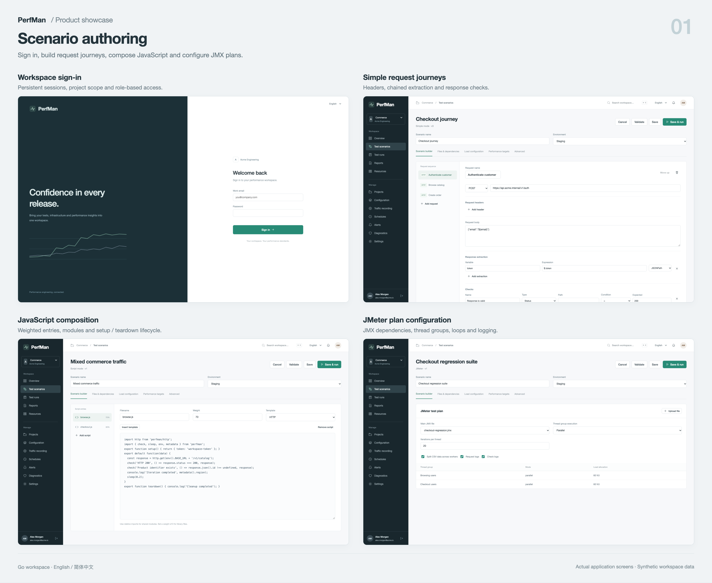
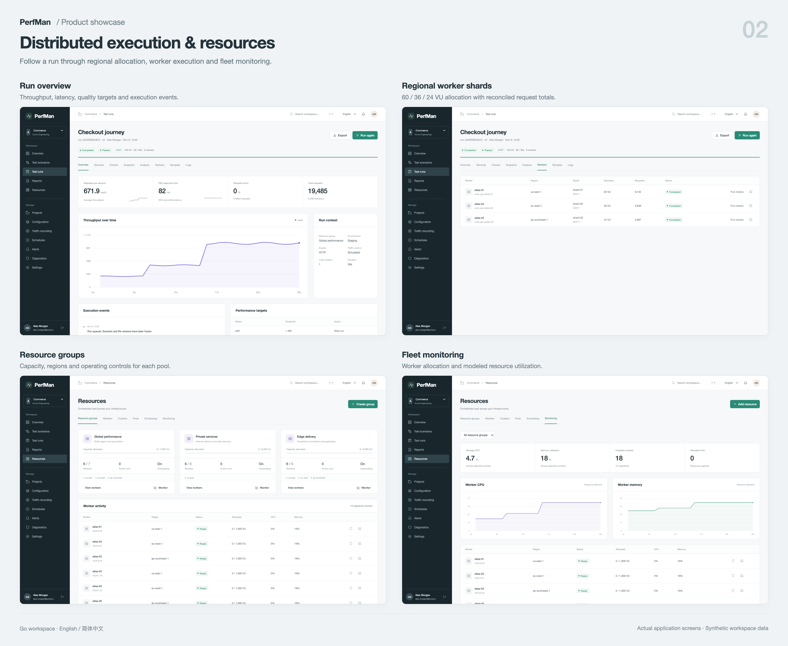
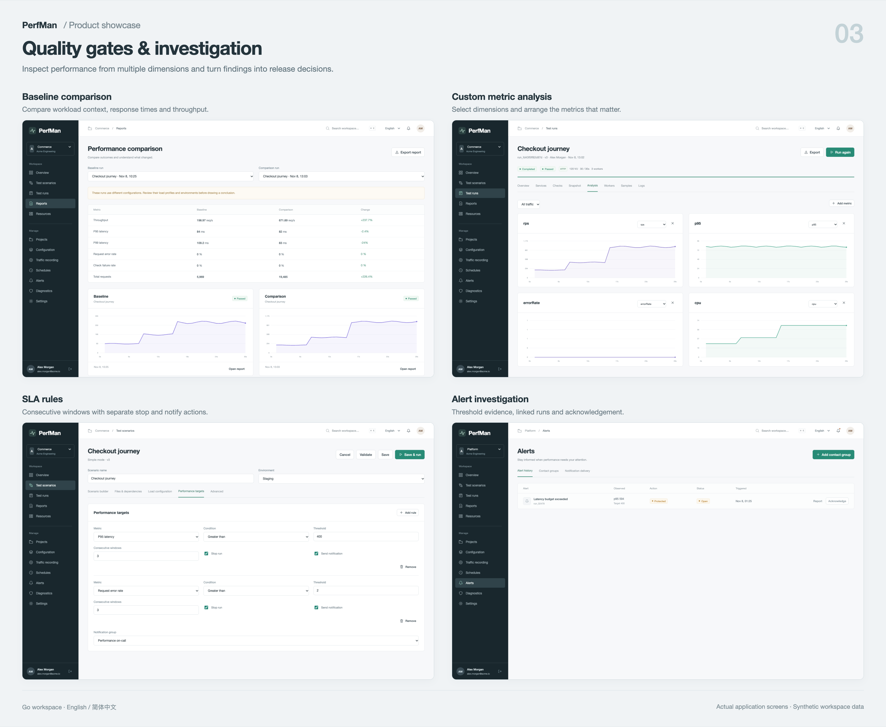
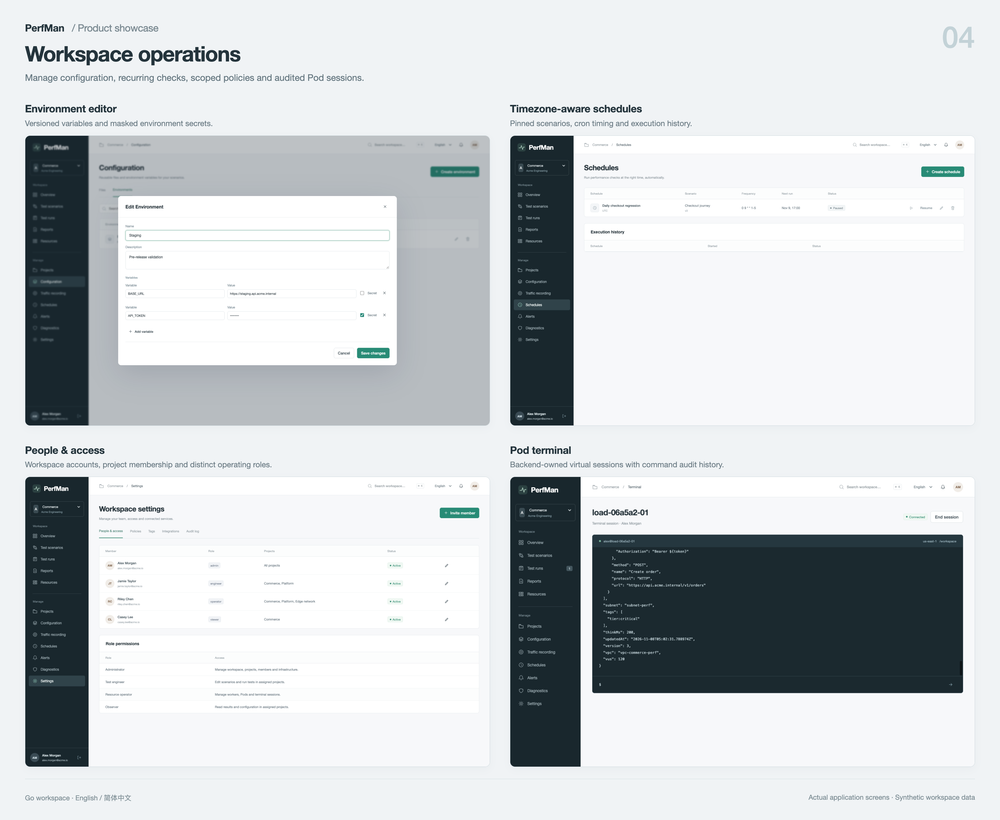

# Product showcase

These are screenshots of the running Go Workspace, captured on 2026-11-08. Accounts, business records and target traffic are synthetic. The default infrastructure and protocol provider is a managed simulator; see the [implementation matrix](../product/IMPLEMENTATION.md) for execution boundaries.

The boards group real screens by workflow. Captions sit outside the application; interface contents are not redrawn. Select a board to open its full-resolution image.

| Author a test | Coordinate execution |
| --- | --- |
| [](01-authoring.png) | [](02-execution.png) |
| **Assess quality** | **Operate the workspace** |
| [](03-quality.png) | [](04-operations.png) |

## Individual screens

| Screen | What it shows |
| --- | --- |
| [Performance overview](screens/overview.png) | Project activity, quality and available capacity |
| [Sign-in](screens/sign-in.png) | Entry to a persistent role-scoped workspace |
| [Simple editor](screens/simple-editor.png) | Request sequence, extraction and assertions |
| [JavaScript editor](screens/script-editor.png) | Entry scripts, weights and executable modules |
| [JMeter editor](screens/jmeter-editor.png) | JMX dependencies, thread settings and logs |
| [Performance targets](screens/performance-targets.png) | SLA windows and stop/notify controls |
| [Run overview](screens/run-overview.png) | Throughput, latency and execution context |
| [Worker shards](screens/worker-shards.png) | Three-region allocation and per-worker counters |
| [Resource fleet](screens/resource-fleet.png) | Resource groups, regions and capacity |
| [Fleet monitoring](screens/resource-monitoring.png) | Allocations and modeled worker utilization |
| [Analysis](screens/run-analysis.png) | Custom metric views and dimensions |
| [Comparison](screens/report-comparison.png) | Baseline and candidate workload results |
| [Alerts](screens/alert-inbox.png) | The Platform project's latency alert and linked report |
| [Environment editor](screens/environment-editor.png) | Variables and masked secrets |
| [Environment list](screens/environment-config.png) | Project environments and scenario references |
| [File library](screens/file-library.png) | Parameter, protocol and test assets |
| [Schedules](screens/schedules.png) | Named cron schedule and its occurrence history |
| [People and access](screens/people-access.png) | Account roles, project membership and status |
| [Policy editor](screens/policy-editor.png) | Project, tag and action scope configuration |
| [Live Pod terminal](05-pod-terminal.png) | A verified managed session reading its frozen run bundle |
| [Chinese console](screens/chinese-resources.png) | Localized resource management with English business data |
| [Mobile overview](screens/mobile-overview.png) | Responsive view at 390 × 844 |

## Provenance and regeneration

[manifest.json](manifest.json) records screen paths, routes, capture date and viewport. Most captures use 1600 × 1000; the terminal image comes from the earlier verified live session on the same day. Boards use the same fixed image frame, preserving aspect ratio and cropping excess height at the bottom. Original captures remain available above.

[gallery.html](gallery.html) is the editable HTML/CSS layout. It has no runtime dependency on the application. Rebuild it from the manifest:

```sh
node scripts/docs/build-gallery.mjs
python3 -m http.server 8055 --bind 127.0.0.1 --directory docs/showcase
```

Open `http://127.0.0.1:8055/gallery.html`. The four `<article>` elements have IDs `authoring`, `execution`, `quality` and `operations`; capture each element at 3200 CSS pixels wide to regenerate its PNG. Stop the temporary static server after capture.

For new application captures, start PerfMan, sign in with a fixture administrator, choose the project/language in the manifest, navigate to its route and capture after the page has settled. Historical run and terminal IDs belong to the documented fixture session; choose equivalent records in a newly initialized workspace.

The older numbered images `01-workspace.png` through `08-mobile-overview.png` retain earlier validation evidence. The root README uses the current boards and `screens/` gallery; `01-workspace.png` depicts the superseded HTTP-only interface.
